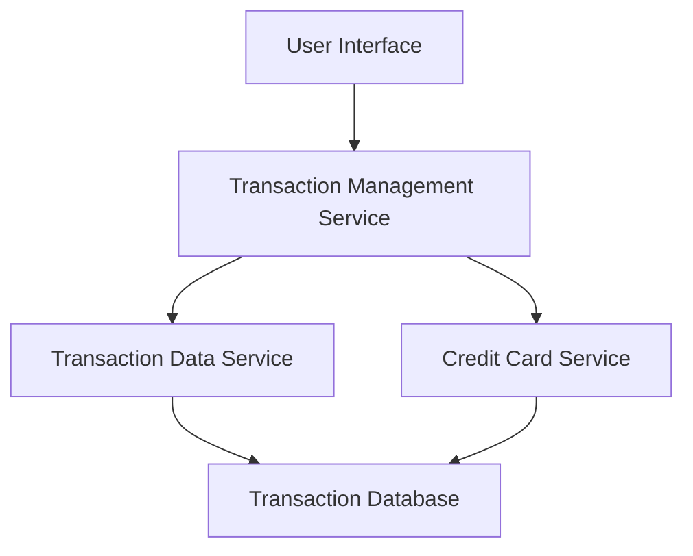

#### 1. High-Level Design

- **Summary:** This epic enables comprehensive transaction tracking across multiple credit cards, providing users with detailed transaction histories, search/filter capabilities, and transaction-level details (merchant, amount, date, category). The system ensures complete visibility into spending activities across all credit cards.

- **Component Flow:**

- **Integration Points:** 
  - **Upstream:** Transaction data service (for retrieving transaction records), Credit card service (for card-transaction mapping)
  - **Downstream:** User interface components for displaying transaction lists and details

- **Key Assumptions:** 
  - Transaction data is pre-categorized by an external service or stored with category metadata
  - Transaction history is retained for at least 12 months in the database

- **NFR Highlights:** Transaction list must support pagination for large datasets; search/filter operations must complete within 1 second; system must handle 12 months of transaction history; responsive layout for mobile and desktop.

- **Data Flow:** User requests transaction data through the UI → Transaction Management Service orchestrates requests → Queries Transaction Data Service and Credit Card Service → Data retrieved from Transaction Database → Results filtered/paginated → Rendered in UI with merchant info, amounts, dates, and categories. Users can apply card-wise filters and search criteria to refine results.

#### 2. Validation Report

- **Requirements Coverage:** The design fully covers the epic's stated scope including transaction list view, transaction details display, transaction history across multiple cards, card-wise filtering, and display of transaction metadata (date, amount, merchant). The architecture supports pagination, search/filter operations within performance constraints (1 second), and 12-month history retention. All NFRs regarding performance, data volume, and responsive design are addressed through appropriate service layers and database design.