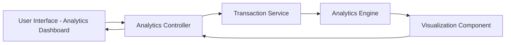

#### 1. High-Level Design

- **Summary:** This epic provides comprehensive spending analytics through interactive visualizations and transaction tracking. Users can analyze spending patterns across nine predefined categories (Food & Dining, Fuel, Shopping, Travel, Entertainment, Utilities, Healthcare, Education, Miscellaneous), view monthly spend trends, and access transaction history for data-driven financial decisions.

- **Component Flow:**

- **Integration Points:**
  - **Upstream:** Transaction Service (provides raw transaction data with category tags and timestamps)
  - **Upstream:** Analytics Engine (processes and aggregates spending data by category and time period)
  - **Downstream:** Visualization Component renders interactive charts and graphs to the Analytics Dashboard UI

- **Key Assumptions:**
  - Transactions are pre-categorized by the Transaction Service or a categorization engine; manual categorization is not in scope.
  - Analytics data is aggregated periodically (e.g., daily batch jobs) or on-demand based on user requests.

- **NFR Highlights:** Analytics visualizations must be interactive and responsive; Category calculations must be accurate and updated in real-time; System must handle large transaction volumes efficiently; Charts and graphs must render quickly.

#### 2. Validation Report

- **Requirements Coverage:** The design fully covers the epic's scope including category-wise spending visualization across nine categories, monthly spend trends, transaction viewing, interactive analytics charts, and spending pattern analysis. The Analytics Engine handles data processing and aggregation, while the Visualization Component ensures interactivity. Integration with Transaction Service and Analytics Engine satisfies stated dependencies. NFRs for interactivity, responsiveness, accuracy, real-time updates, large volume handling, and quick rendering are addressed through the modular architecture and dedicated analytics processing layer.