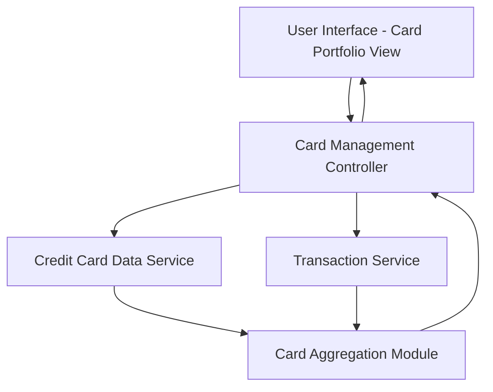

#### 1. High-Level Design

- **Summary:** This epic enables users to manage and view multiple credit cards in a single consolidated interface. Users can see all registered credit cards with details including card type, credit limits, current balances, and card-specific information, providing a comprehensive portfolio overview for easy comparison and monitoring.

- **Component Flow:**

- **Integration Points:**
  - **Upstream:** Credit Card Data Service (retrieves card information, limits, and balances for all user cards)
  - **Upstream:** Transaction Service (provides card-wise spending data and transaction details)
  - **Downstream:** Card Portfolio View UI displays aggregated multi-card data to users

- **Key Assumptions:**
  - Each user has a unique identifier linking them to their credit card portfolio; card ownership is pre-established.
  - Card data is retrieved via batch or individual API calls depending on the number of cards per user.

- **NFR Highlights:** System must support viewing and managing multiple credit cards per user; Card data must be displayed accurately and consistently; Interface must handle varying numbers of cards without performance degradation.

#### 2. Validation Report

- **Requirements Coverage:** The design addresses all scope elements including multiple credit card display, card details view, card-wise spend analysis, individual card credit limit tracking, and card-specific balance information. The Card Aggregation Module ensures consistent handling of multiple cards. Integration dependencies with Credit Card Data Service and Transaction Service are satisfied. NFRs for multi-card support, data accuracy, and performance scalability are incorporated through the aggregation layer and service-oriented architecture.