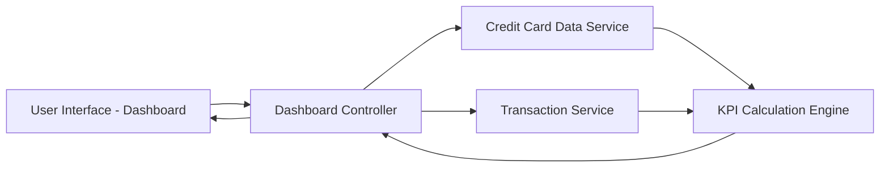

#### 1. High-Level Design

- **Summary:** This epic delivers a centralized dashboard that displays key performance indicators (KPIs) for credit card portfolio management. Users can view monthly spend, total credit limit, available credit, and outstanding amounts across all credit cards in a responsive interface, providing immediate visibility into credit card financial health.

- **Component Flow:**

- **Integration Points:**
  - **Upstream:** Credit Card Data Service (retrieves card balances and credit limits)
  - **Upstream:** Transaction Service (provides monthly spend and outstanding amounts data)
  - **Downstream:** Dashboard UI renders KPI data to end users

- **Key Assumptions:**
  - KPI data refresh occurs in near real-time or at regular intervals (e.g., every few seconds or on user action).
  - Credit Card Data Service and Transaction Service provide standardized JSON/REST API responses with consistent data schemas.

- **NFR Highlights:** Dashboard must be responsive across desktop, tablet, and mobile devices; KPI calculations must be accurate and real-time; Interface must load within acceptable performance thresholds.

#### 2. Validation Report

- **Requirements Coverage:** The design fully covers the epic's stated scope including dashboard interface, all four KPIs (Monthly Spend, Total Credit Limit, Available Credit, Outstanding Amount), and responsive layout design. Integration with required backend services (Credit Card Data Service and Transaction Service) is addressed. NFRs for responsiveness, accuracy, and performance are incorporated into the architecture through the KPI Calculation Engine and service-based design pattern.