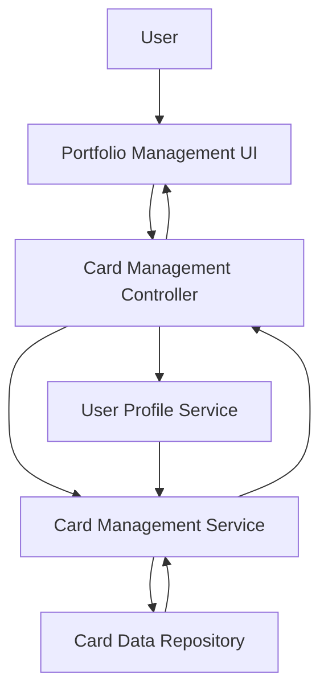

#### 1. High-Level Design

- **Summary**: This epic enables users to manage and monitor multiple credit cards (up to 10 per user) within a unified interface. Users can view individual card details including credit limits, balances, and card-specific information, while maintaining a holistic portfolio view. The system ensures secure data isolation between cards and provides sub-300ms data retrieval latency for optimal user experience.

- **Component Flow**:

- **Integration Points**: 
  - **Upstream**: User Profile Service (handles user authentication and authorization), Card Management Service (stores and retrieves card information)
  - **Downstream**: Card Data Repository (persistent storage for card details), Portfolio Management UI (displays multi-card views)

- **Key Assumptions**: 
  - Card data is stored in a normalized format with user_id as the primary key for data isolation, ensuring security across multi-card views.
  - Card Management Service supports batch retrieval of multiple cards in a single API call to meet the 300ms latency requirement.

- **NFR Highlights**: System must support management of at least 10 credit cards per user, card data retrieval latency must be under 300ms, and ensure data isolation and security for multi-card views.

- **Data Flow**: User logs in → User Profile Service authenticates user → Portfolio Management UI requests card list from Card Management Controller → Controller queries Card Management Service with user_id → Service retrieves all associated cards from Card Data Repository (batch operation) → Individual card details (credit limit, outstanding balance, card-specific info) are returned → Portfolio Management UI renders both individual card views and consolidated portfolio overview → User can select specific cards for detailed view or monitor all cards in aggregate.

#### 2. Validation Report

- **Requirements Coverage**: The design fully addresses the epic's scope including multiple credit card display, individual card details view, card-wise credit limit tracking, card-wise outstanding balance display, and card portfolio overview. All NFRs are satisfied: support for at least 10 cards per user, sub-300ms retrieval latency through batch operations, and data isolation/security through user_id-based access control. Dependencies on User Profile Service and Card Management Service are clearly defined with appropriate authentication and data retrieval flows. Out-of-scope items (real bank integration, card payments, fund transfers, loans, adding new physical credit cards) are correctly excluded. The architecture supports both granular card-level views and holistic portfolio management as required.