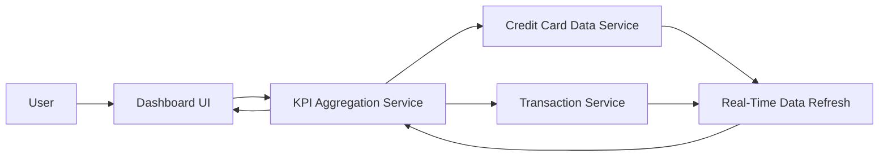

#### 1. High-Level Design

- **Summary**: This epic delivers a centralized, responsive dashboard that consolidates key performance indicators for a user's entire credit card portfolio. The dashboard displays real-time metrics including monthly spend, total credit limit, available credit, and outstanding amounts. It serves as the primary entry point for users to assess their credit card financial health at a glance, supporting both mobile and desktop devices with sub-2-second load times.

- **Component Flow**:

- **Integration Points**: 
  - **Upstream**: Credit Card Data Service (retrieves card balances, limits, and outstanding amounts), Transaction Service (provides monthly spend calculations)
  - **Downstream**: KPI Aggregation Service (consolidates data from multiple sources), Real-Time Data Refresh mechanism (ensures KPI currency)

- **Key Assumptions**: 
  - Credit Card Data Service and Transaction Service provide REST/GraphQL APIs with response times under 500ms to meet the 2-second dashboard load requirement.
  - Available credit is calculated as (Total Credit Limit - Outstanding Amount) and does not require complex business logic or external validation.

- **NFR Highlights**: Dashboard must load within 2 seconds, support responsive design across mobile and desktop devices, and handle real-time data refresh for KPI updates.

- **Data Flow**: User accesses dashboard → Dashboard UI requests KPI data from KPI Aggregation Service → Service queries Credit Card Data Service for card limits, balances, and outstanding amounts → Service queries Transaction Service for monthly spend totals → Real-Time Data Refresh ensures data currency → Aggregated KPIs (monthly spend, total credit limit, available credit, outstanding amount) are returned to Dashboard UI → Responsive layout renders consolidated view to User.

#### 2. Validation Report

- **Requirements Coverage**: The design comprehensively addresses all stated scope elements: monthly spend display, total credit limit aggregation, available credit calculation, outstanding amount tracking, responsive dashboard layout, and consolidated KPI view. All NFRs are satisfied through the KPI Aggregation Service architecture (2-second load time, responsive design, real-time refresh). Dependencies on Credit Card Data Service and Transaction Service are explicitly defined. Out-of-scope items (real bank integration, card payments, fund transfers, payment gateway integration) are appropriately excluded. The design provides a clear path from user interaction to data aggregation to visualization.