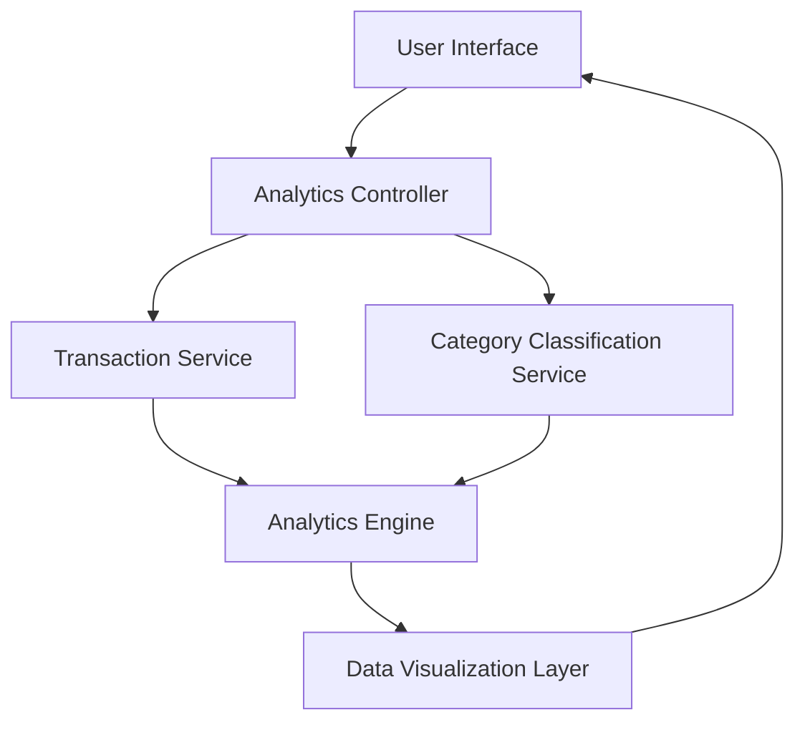

#### 1. High-Level Design

- **Summary**: This epic delivers an analytics and insights module that provides users with interactive visualizations of their credit card spending patterns. The system aggregates transaction data across multiple time periods and categories (Food & Dining, Fuel, Shopping, Travel, Entertainment, Utilities, Healthcare, Education, Miscellaneous), enabling users to identify spending trends and make informed financial decisions. The module supports monthly trend analysis and card-wise spending breakdowns with responsive visualization rendering.

- **Component Flow**:

- **Integration Points**: 
  - **Upstream**: Transaction Service (provides raw transaction data), Category Classification Service (categorizes transactions into predefined categories)
  - **Downstream**: Analytics Engine (aggregates and processes data for trend calculation), Data Visualization Layer (renders charts and graphs)

- **Key Assumptions**: 
  - Transaction data is pre-classified into the nine predefined categories by the Category Classification Service; no manual categorization is required.
  - Historical transaction data for at least 12 months is available and accessible via the Transaction Service API.

- **NFR Highlights**: Analytics queries must execute within 1 second, support 12 months of historical data, and visualization rendering must be optimized for responsive display across devices.

- **Data Flow**: User requests analytics view → Analytics Controller fetches transaction data from Transaction Service → Category Classification Service provides category mappings → Analytics Engine aggregates data by time period and category → Processed insights are formatted by Data Visualization Layer → Interactive charts/graphs are rendered to User Interface showing monthly trends, card-wise analysis, and category-wise breakdowns.

#### 2. Validation Report

- **Requirements Coverage**: The design fully covers the epic's stated scope including monthly spend trend visualization, card-wise spend analysis, category-wise spending breakdown across nine categories, and interactive charts. All NFRs (1-second query execution, 12-month historical data, responsive rendering) are addressed through the Analytics Engine and Data Visualization Layer. Integration dependencies with Transaction Service, Analytics Engine, and Category Classification Service are clearly mapped. Out-of-scope items (real bank integration, predictive analytics, budget alerts, spending recommendations, export functionality) are explicitly excluded from the design.