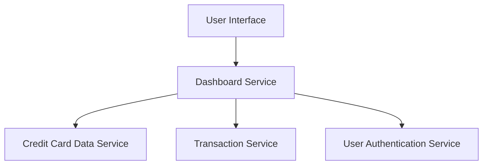

#### 1. High-Level Design

- **Summary:** This epic delivers a modern, responsive dashboard interface that displays critical financial KPIs at a glance. Users can monitor monthly spend, total credit limit across all cards, available credit, and outstanding amounts in a consolidated view. The dashboard provides real-time visibility into overall credit card financial health, enabling informed spending decisions and effective credit utilization tracking.

- **Component Flow:**

- **Integration Points:**
  - **Upstream:** User Authentication Service (for secure access and user session management)
  - **Downstream:** Credit Card Data Service (for card details, credit limits, balances), Transaction Service (for calculating monthly spend and outstanding amounts)

- **Key Assumptions:**
  - Monthly spend is calculated based on the current calendar month's transactions aggregated across all user cards.
  - Available credit is computed as (Total Credit Limit - Outstanding Amount) and updated in near real-time.

- **NFR Highlights:** Dashboard must load within 2 seconds; responsive design for mobile, tablet, desktop; real-time data refresh capability; support concurrent multi-user viewing.

- **Data Flow:** User logs in via User Authentication Service → Dashboard Service authenticates user and requests KPI data → Credit Card Data Service provides total credit limit, available credit, and outstanding amounts across all cards → Transaction Service calculates current month's spend → Dashboard Service aggregates KPIs (monthly spend, total limit, available credit, outstanding) → KPI visualization components render data on responsive UI → Dashboard supports real-time refresh to update KPIs as new transactions occur.

#### 2. Validation Report

- **Requirements Coverage:** The design fully addresses the epic's scope including monthly spend display, total credit limit aggregation, available credit calculation, outstanding amount tracking, responsive dashboard layout, and KPI visualization components. All NFRs (2-second load time, responsive design for multiple viewports, real-time refresh, concurrent user support) are incorporated into the Dashboard Service architecture. Integration dependencies with Credit Card Data Service, Transaction Service, and User Authentication Service are explicitly mapped and support the required real-time KPI calculations and secure access.