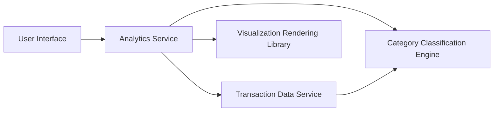

#### 1. High-Level Design

- **Summary:** This epic provides interactive visualizations and analytics to help users understand spending behavior across nine predefined categories (Food & Dining, Fuel, Shopping, Travel, Entertainment, Utilities, Healthcare, Education, Miscellaneous). Users can analyze monthly spend trends over time (up to 12 months) and explore category-wise spending patterns through interactive charts and graphs, enabling data-driven financial planning and budget management.

- **Component Flow:**

- **Integration Points:**
  - **Upstream:** Transaction Data Service (for historical spending data up to 12 months)
  - **Downstream:** Category Classification Engine (for transaction categorization into 9 predefined categories), Analytics Rendering Library (for chart and graph generation)

- **Key Assumptions:**
  - Transactions are pre-categorized or categorized in real-time by the Category Classification Engine using predefined rules.
  - Historical transaction data is retained for at least 12 months and is readily accessible for analytics queries.

- **NFR Highlights:** Visualizations must render within 3 seconds; support interactive filtering and drill-down; handle 12 months of transaction history; responsive charts across all device sizes.

- **Data Flow:** User requests spending analytics → Analytics Service queries Transaction Data Service for historical transactions (up to 12 months) → Category Classification Engine categorizes transactions into 9 predefined categories → Analytics Service aggregates data by month and category → Visualization Rendering Library generates interactive charts (monthly trends, category breakdowns) → User interacts with visualizations (filtering, drill-down) → UI updates dynamically based on user selections.

#### 2. Validation Report

- **Requirements Coverage:** The design comprehensively covers the epic's scope including monthly spend trend visualization, category-wise spending analysis, interactive charts, spending pattern identification, nine category tracking, time-based filtering, and visual breakdowns. All NFRs (3-second render time, interactive capabilities, 12-month history, responsive design) are addressed through the Analytics Service and Visualization Rendering Library. Integration dependencies with Transaction Data Service, Category Classification Engine, and Analytics Rendering Library are clearly defined and support the required functionality.