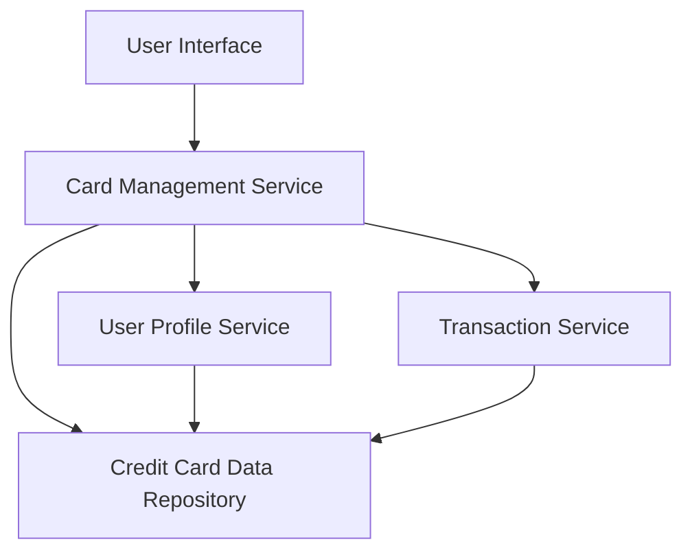

#### 1. High-Level Design

- **Summary:** This epic enables users to view and manage multiple credit cards (up to 20) within a unified interface. The core requirement is to provide a consolidated view of all user credit cards with individual card details, balances, credit limits, and card-wise spending analysis. Users can select, filter, and compare cards to optimize usage and track spending patterns across their credit card portfolio.

- **Component Flow:**

- **Integration Points:**
  - **Upstream:** User Profile Service (for user-card associations and authentication)
  - **Downstream:** Credit Card Data Repository (for card details, limits, balances), Transaction Service (for card-wise spend calculations and transaction history)

- **Key Assumptions:**
  - Card data is stored in a structured format with standardized fields (card number, limit, balance, issuer).
  - Card numbers are masked at the data layer before being sent to the UI (e.g., showing only last 4 digits).

- **NFR Highlights:** System must support up to 20 cards per user with card data retrieval latency under 500ms; secure storage with masked card numbers required.

- **Data Flow:** User authenticates and requests card portfolio view → Card Management Service queries User Profile Service to retrieve associated card IDs → Service fetches card details (limits, balances) from Credit Card Data Repository → Transaction Service calculates card-wise spend for each card → Aggregated data (card details + spend analysis) is returned to UI → User can filter, select, and view individual card details with spending breakdowns.

#### 2. Validation Report

- **Requirements Coverage:** The design fully covers the epic's stated scope including multiple card display, card listing interface, card-wise spend breakdown, individual card details view, balance tracking, and card selection/filtering. All NFRs (20 cards support, <500ms latency, secure masked display) are addressed through the component architecture. Integration dependencies with Credit Card Data Repository, User Profile Service, and Transaction Service are explicitly mapped in the component flow.