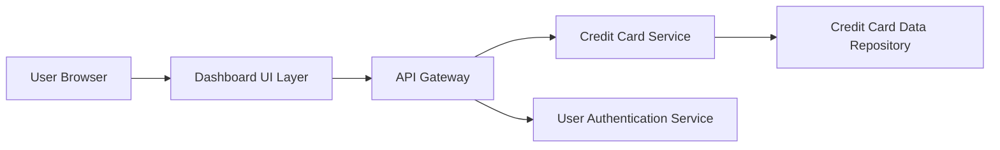

#### 1. High-Level Design

- **Summary:** This epic delivers a responsive Credit Card Analysis Dashboard that provides consolidated visibility into multiple credit cards (up to 10) with key performance indicators including Monthly Spend, Total Credit Limit, Available Credit, and Outstanding Amount. The dashboard enables users to monitor their credit card portfolio from a single, device-adaptive interface.

- **Component Flow:**

- **Integration Points:**
  - **Upstream:** User Authentication Service (for user identity verification and session management)
  - **Downstream:** Credit Card Data Source/Repository (for retrieving credit card details, limits, balances, and spending data)

- **Key Assumptions:** 
  - Credit card data is refreshed in near real-time or at regular intervals (e.g., hourly) to ensure KPI accuracy.
  - User authentication tokens are managed by the authentication service and validated on each dashboard request.

- **NFR Highlights:** Dashboard must load within 2 seconds; support responsive design across desktop/tablet/mobile devices; handle display of up to 10 credit cards simultaneously.

#### 2. Validation Report

- **Requirements Coverage:** The design addresses all stated requirements including KPI display (Monthly Spend, Total Credit Limit, Available Credit, Outstanding Amount), multi-card view support, and responsive layout implementation. The architecture supports the 2-second load time requirement through efficient API gateway routing and data retrieval patterns. The design accommodates up to 10 credit cards as specified in NFRs.