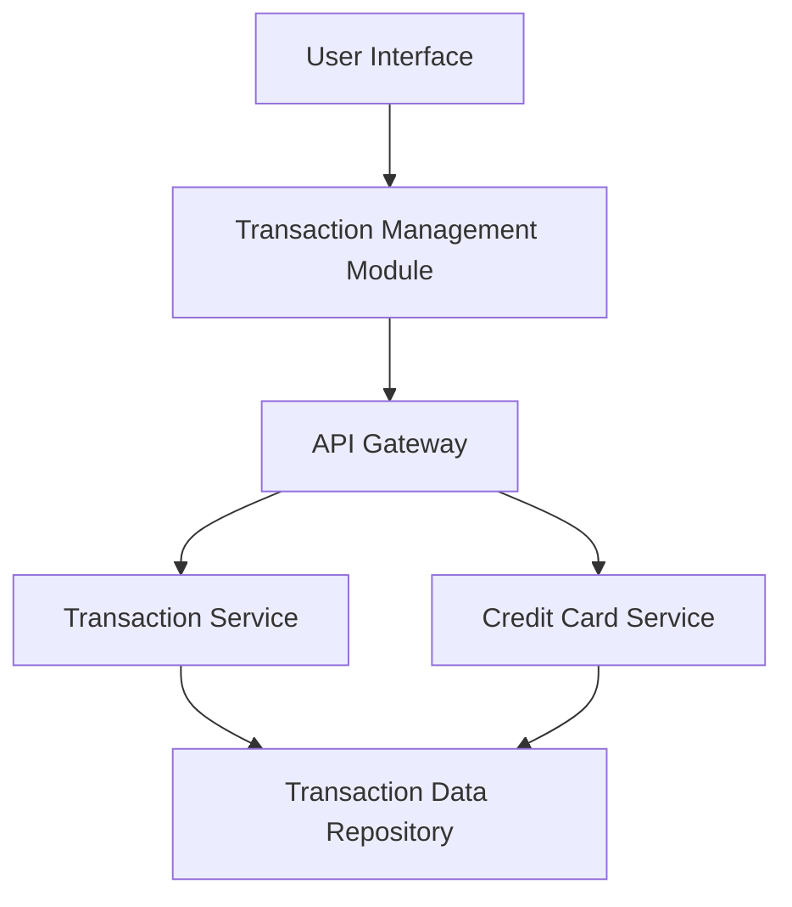

#### 1. High-Level Design

- **Summary:** This epic enables users to view, search, and filter credit card transactions across all their credit cards. Users can access detailed transaction histories including merchant names, amounts, dates, and categories, with support for at least 12 months of historical data. The system provides pagination for large datasets and delivers query results within 1 second.

- **Component Flow:**

- **Integration Points:**
  - **Upstream:** User Authentication Service (for user session validation and access control)
  - **Downstream:** Transaction Data Repository (for retrieving transaction records), Credit Card Data Service (for linking transactions to specific credit cards)

- **Key Assumptions:** 
  - Transactions are stored with indexed fields (date, merchant, category, card ID) to support sub-second query performance.
  - Pagination defaults to a reasonable page size (e.g., 20-50 transactions per page) to balance performance and usability.

- **NFR Highlights:** Transaction queries must return results within 1 second; transaction list must support pagination for large datasets; system must handle transaction history for at least 12 months.

#### 2. Validation Report

- **Requirements Coverage:** The design covers all core requirements including transaction listing, detail view, multi-card aggregation, search and filtering, and history display. The architecture supports the 1-second query response time through efficient indexing and pagination strategies. The 12-month historical data requirement is addressed through the data repository design with appropriate data retention policies.