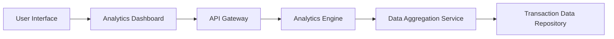

#### 1. High-Level Design

- **Summary:** This epic delivers interactive visualizations and analytics for understanding spending patterns across nine predefined categories (Food & Dining, Fuel, Shopping, Travel, Entertainment, Utilities, Healthcare, Education, Miscellaneous). Users can analyze Monthly Spend Trends and Card-wise Spend Analysis with drill-down capabilities for up to 12 months of transaction history.

- **Component Flow:**

- **Integration Points:**
  - **Upstream:** User Authentication Service (for user access control)
  - **Downstream:** Transaction Data Repository (for raw transaction data), Credit Card Data Service (for card-specific spending analysis), Data Aggregation Service (for pre-computed spending summaries and category totals)

- **Key Assumptions:** 
  - Transaction categorization (into the nine categories) is performed either at transaction ingestion time or through a separate categorization service.
  - Data aggregation service pre-computes monthly and category-wise summaries to meet the 3-second rendering requirement.

- **NFR Highlights:** Analytics visualizations must render within 3 seconds; support interactive filtering and drill-down capabilities; handle data aggregation for up to 12 months of transaction history.

#### 2. Validation Report

- **Requirements Coverage:** The design addresses all requirements including category-wise spending visualization across nine categories, monthly spend trend analysis, card-wise spend analysis, interactive charts, and spending pattern identification. The architecture supports the 3-second rendering requirement through pre-aggregated data and efficient analytics engine design. Interactive filtering and drill-down capabilities are enabled through the analytics dashboard component with appropriate API support.