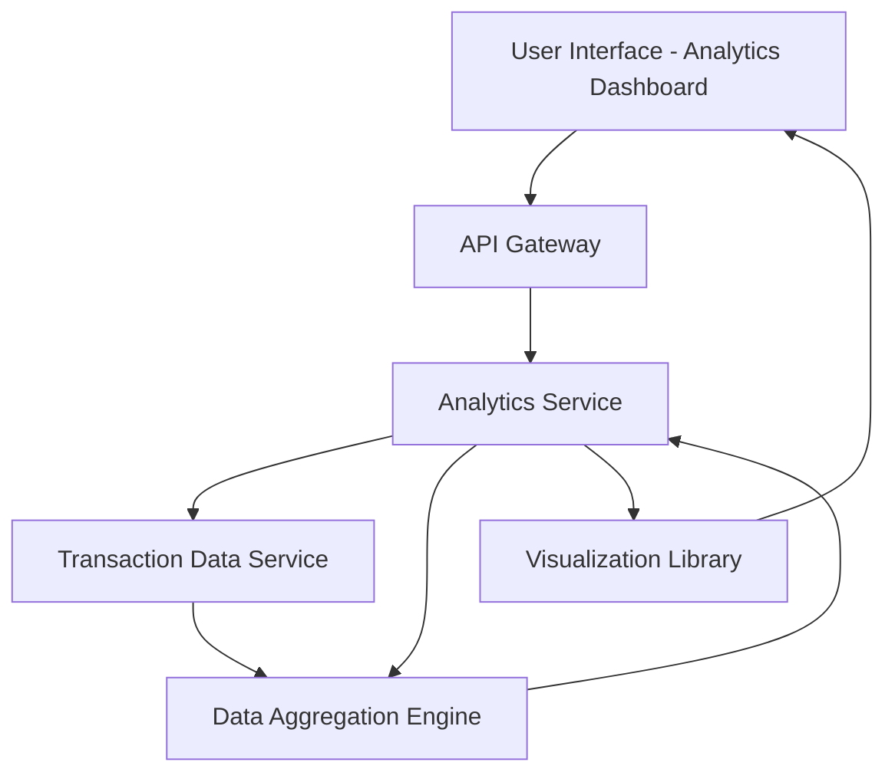

#### 1. High-Level Design

- **Summary:** This epic provides interactive analytics and visualization capabilities for understanding spending patterns through category-wise breakdowns (Food & Dining, Fuel, Shopping, Travel, Entertainment, Utilities, Healthcare, Education, Miscellaneous) and monthly spend trend analysis. The feature enables users to track spending behavior over time with at least 12 months of historical data and identify opportunities for financial optimization.

- **Component Flow:**

- **Integration Points:**
  - **Upstream:** Transaction data service for retrieving categorized transaction history
  - **Upstream:** Data aggregation engine for calculating category totals and trends
  - **Downstream:** Visualization library for rendering interactive charts
  - **Downstream:** User interface for displaying analytics and insights

- **Key Assumptions:**
  - Transactions are pre-categorized at the time of ingestion or via automated categorization rules
  - Historical transaction data for 12 months is readily available and indexed for efficient aggregation queries

- **NFR Highlights:** Analytics visualizations must render within 3 seconds; system must support data aggregation for at least 12 months of transaction history; charts must be interactive and responsive across devices

#### 2. Validation Report

- **Requirements Coverage:** The design comprehensively covers all stated requirements including category-wise spending visualization across all 9 specified categories, monthly spend trend analysis, interactive charts, transaction categorization, and historical pattern analysis. The architecture addresses the 3-second rendering requirement through dedicated analytics service and data aggregation engine, and supports 12-month historical data retention. The visualization library component ensures interactive and responsive chart rendering across devices.