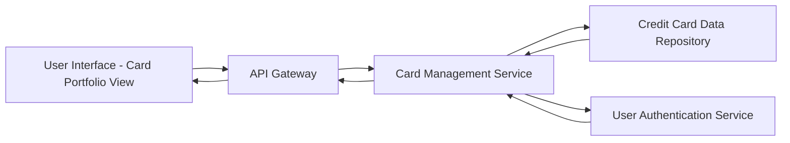

#### 1. High-Level Design

- **Summary:** This epic enables users to manage and monitor multiple credit cards (up to 10 per user) from a unified interface. Users can view card-specific details including credit limits, available credit, and outstanding balances for each card, and perform card-wise spend analysis to compare spending patterns across different cards and optimize credit utilization strategy.

- **Component Flow:**

- **Integration Points:**
  - **Upstream:** Credit Card data repository for storing and retrieving multiple card information
  - **Upstream:** User authentication service for associating cards with user accounts
  - **Downstream:** User interface for displaying card portfolio and comparison views

- **Key Assumptions:**
  - Each user account is uniquely identified and can be linked to up to 10 credit cards via user authentication service
  - Card data is retrieved via batch API calls with response times under 500ms per request

- **NFR Highlights:** System must support at least 10 credit cards per user; card data retrieval latency must be under 500ms; interface must maintain performance with multiple cards displayed simultaneously

#### 2. Validation Report

- **Requirements Coverage:** The design addresses all functional requirements including multi-card display, card-wise spend analysis, individual card metrics (credit limit, available credit, outstanding balance), and card comparison capabilities. The architecture supports the NFR of 10 cards per user and sub-500ms latency through dedicated card management service and optimized data repository access. Authentication integration ensures proper card-to-user association.