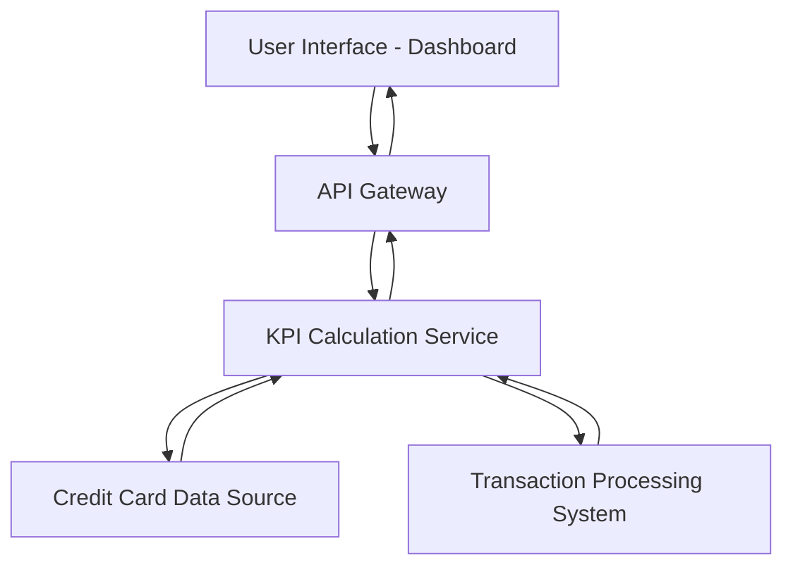

#### 1. High-Level Design

- **Summary:** This epic delivers a consolidated dashboard that displays key performance indicators (KPIs) for the user's credit card portfolio, including Monthly Spend, Total Credit Limit, Available Credit, and Outstanding Amount. The dashboard provides real-time visibility into financial health and credit utilization through a responsive interface accessible on both mobile and desktop devices.

- **Component Flow:**

- **Integration Points:**
  - **Upstream:** Credit Card data source for retrieving card balances and limits
  - **Upstream:** Transaction processing system for calculating monthly spend and outstanding amounts
  - **Downstream:** User interface layer (web/mobile) for rendering dashboard

- **Key Assumptions:** 
  - KPI data is aggregated in near real-time with a refresh interval of 30-60 seconds
  - Credit card data and transaction data are available via RESTful APIs with standardized JSON format

- **NFR Highlights:** Dashboard must load within 2 seconds; support responsive design for mobile and desktop; handle real-time data refresh for KPI updates

#### 2. Validation Report

- **Requirements Coverage:** The design fully covers the epic's stated scope by including all four KPIs (Monthly Spend, Total Credit Limit, Available Credit, Outstanding Amount), responsive layout, and consolidated multi-card view. The component flow demonstrates integration with required data sources and addresses the 2-second load time requirement through dedicated KPI calculation service and API gateway pattern.