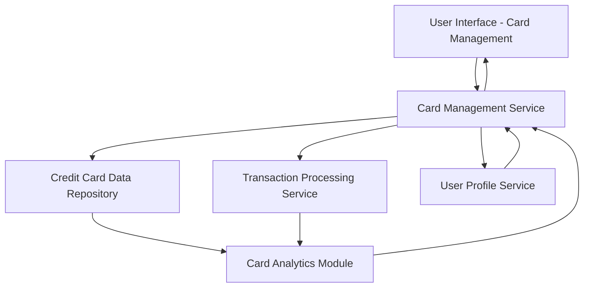

#### 1. High-Level Design

- **Summary:** This epic enables users to manage and monitor multiple credit cards (up to 10+ per user) through a consolidated interface. Users can view all their cards, analyze card-specific spending patterns, track individual card utilization, monitor card balances, and access detailed transaction listings per card. The feature provides comprehensive card portfolio management capabilities to optimize multi-card usage.

- **Component Flow:**

- **Integration Points:**
  - **Upstream:** Credit Card Data Repository (for card information including card details, limits, balances, and metadata)
  - **Upstream:** Transaction Processing Service (for card-specific transaction history and real-time transaction data)
  - **Upstream:** User Profile Service (for card ownership validation and user-card relationship management)
  - **Internal:** Card Analytics Module (for calculating card utilization metrics and card-wise spend analysis)

- **Key Assumptions:**
  - Card ownership is validated through User Profile Service; users can only view and manage cards explicitly linked to their profile.
  - Card data synchronization occurs through periodic polling or event-driven updates from the Credit Card Data Repository; the frequency is optimized for minimal latency as specified in NFRs.

- **NFR Highlights:** System must support management of at least 10 credit cards per user, card data synchronization must occur with minimal latency, and interface must maintain performance with large transaction volumes.

- **Data Flow:** User accesses Card Management interface → Card Management Service validates user identity via User Profile Service → Service retrieves all cards owned by user from Credit Card Data Repository → For each card, Transaction Processing Service provides transaction history → Card Analytics Module calculates card-specific metrics (utilization = balance/limit, monthly spend per card, transaction count) → Card Management Service aggregates card data with analytics → UI displays card list with key metrics → User selects specific card for detailed view → System retrieves and displays card details, full transaction listing, and card-wise spend analysis → User can compare cards and monitor individual card performance.

#### 2. Validation Report

- **Requirements Coverage:** The design fully addresses all scope requirements including multiple credit card display, card-wise spend analysis, individual card balance tracking, card utilization monitoring, card details view, and transaction listing per card. All NFRs are satisfied: support for 10+ cards per user (validated through User Profile Service and Card Management Service architecture), minimal latency card data synchronization (addressed through optimized data retrieval and caching strategies), and performance with large transaction volumes (handled through Transaction Processing Service and efficient query design). All integration dependencies with credit card data repository, transaction processing service, and user profile service are explicitly mapped and validated in the component architecture.