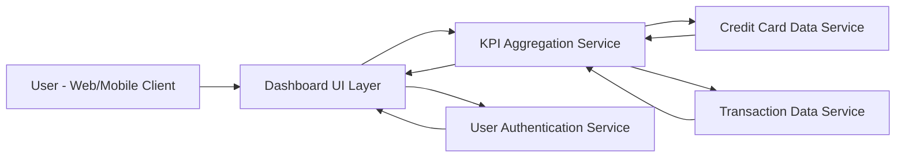

#### 1. High-Level Design

- **Summary:** This epic provides a consolidated dashboard that displays critical financial KPIs across all user credit cards, including monthly spending, total credit limit, available credit, and outstanding amounts. The dashboard serves as a single-pane view for users to quickly assess their overall credit card financial health and make informed spending decisions through real-time metric updates.

- **Component Flow:**

- **Integration Points:**
  - **Upstream:** Credit Card Data Service (for retrieving card balances, credit limits, and card details)
  - **Upstream:** Transaction Data Service (for retrieving transaction history to calculate monthly spending)
  - **Upstream:** User Authentication Service (for secure access control and user identity validation)
  - **Downstream:** Dashboard UI Layer (responsive interface for desktop and mobile rendering)

- **Key Assumptions:**
  - KPI calculations (total credit limit, available credit, outstanding amounts) are aggregated across all cards owned by the authenticated user; card ownership is validated through user profile.
  - Real-time data refresh refers to on-demand refresh triggered by user action or periodic polling (e.g., every 30-60 seconds), not streaming updates.

- **NFR Highlights:** Dashboard must load within 2 seconds, support responsive design across desktop and mobile devices, and handle real-time data refresh for KPI updates.

- **Data Flow:** User authenticates via Authentication Service → Dashboard UI requests KPI data → KPI Aggregation Service queries Credit Card Data Service for all user cards (limits, balances, outstanding) → KPI Aggregation Service queries Transaction Data Service for current month transactions → Service calculates aggregated metrics (total credit limit = sum of all card limits, available credit = total limit minus total outstanding, monthly spend = sum of current month transactions) → Aggregated KPIs returned to Dashboard UI → Dashboard renders responsive layout with visualized metrics → User can trigger refresh to update KPIs in near real-time.

#### 2. Validation Report

- **Requirements Coverage:** The design comprehensively addresses all scope elements: monthly spend display, total credit limit calculation, available credit tracking, outstanding amount monitoring, responsive dashboard layout, and KPI visualization. All NFRs are covered including the 2-second load time requirement (addressed through efficient KPI aggregation), responsive design support (UI layer specification), and real-time data refresh capability (KPI Aggregation Service design). Integration dependencies with credit card data service, transaction data service, and user authentication service are explicitly defined and mapped in the component flow.