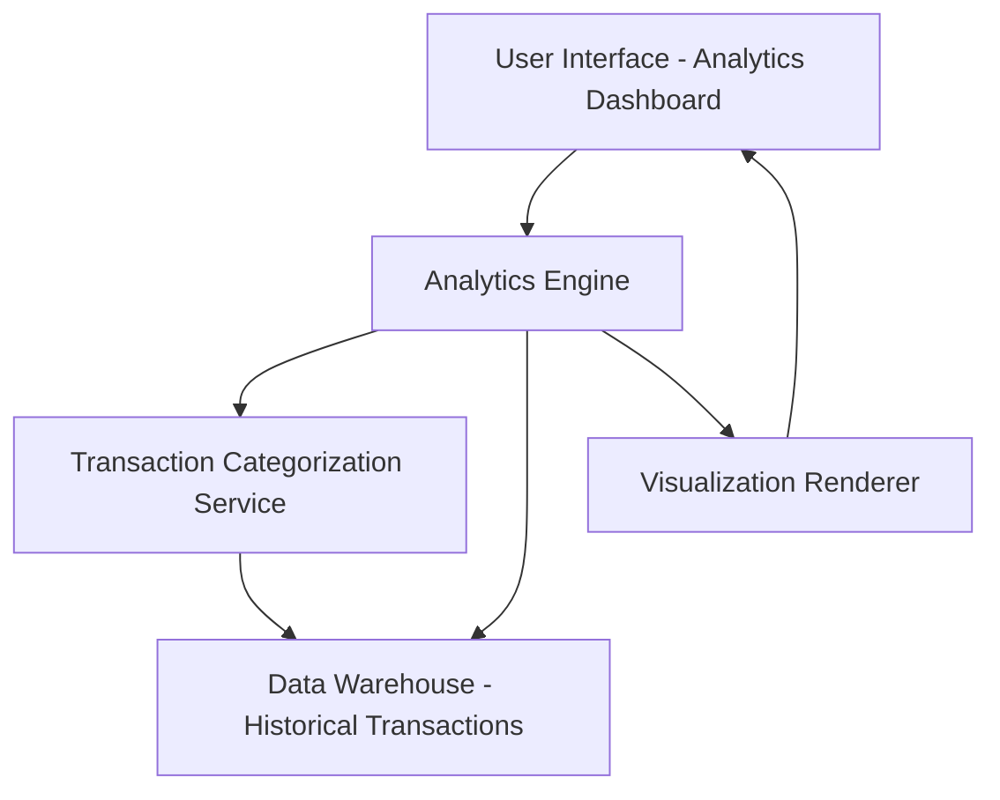

#### 1. High-Level Design

- **Summary:** This epic delivers an analytics and insights module that enables users to visualize and analyze their credit card spending patterns across nine predefined categories (Food & Dining, Fuel, Shopping, Travel, Entertainment, Utilities, Healthcare, Education, Miscellaneous). The system provides interactive visualizations, monthly trend analysis, and historical spending comparisons to help users understand their financial behavior and identify optimization opportunities.

- **Component Flow:**

- **Integration Points:**
  - **Upstream:** Transaction Categorization Service (for automatic category assignment of transactions)
  - **Upstream:** Data Warehouse (for historical transaction data retrieval spanning at least 12 months)
  - **Upstream:** Analytics Engine (for trend calculation and spending pattern analysis)
  - **Downstream:** User Interface layer (for rendering interactive charts and visualizations)

- **Key Assumptions:**
  - Transaction categorization is performed automatically by an existing service using rule-based or ML-based classification; manual re-categorization by users is not in scope.
  - Data refresh frequency for analytics is assumed to be daily batch updates; real-time transaction categorization is not required.

- **NFR Highlights:** Analytics visualizations must render within 3 seconds, support interactive filtering and drill-down, handle 12+ months of historical data, and maintain high accuracy in category classification.

- **Data Flow:** User requests analytics view → Analytics Engine queries Data Warehouse for historical transactions → Transaction Categorization Service provides category mappings → Analytics Engine aggregates spending by category and time period → Visualization Renderer generates interactive charts (category-wise pie/bar charts, monthly trend line graphs) → Results displayed on Analytics Dashboard with filtering capabilities → User interacts with visualizations to drill down into specific categories or time periods.

#### 2. Validation Report

- **Requirements Coverage:** The design fully covers the epic's stated scope including category-wise spending visualization, monthly spend trend analysis, interactive charts, spending pattern identification, nine-category classification, and historical spending comparison. All NFRs regarding rendering performance (3 seconds), interactive capabilities, 12-month historical data handling, and category classification accuracy are addressed through the component architecture. Integration dependencies with transaction categorization service, analytics engine, and data warehouse are explicitly mapped in the design.