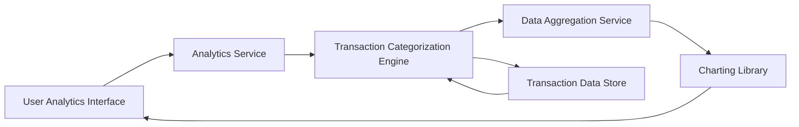

#### 1. High-Level Design

- **Summary:** This epic delivers advanced spending analytics through interactive visualizations, enabling users to analyze spending patterns across nine predefined categories (Food & Dining, Fuel, Shopping, Travel, Entertainment, Utilities, Healthcare, Education, Miscellaneous). The core requirement is to provide category-wise breakdowns, monthly spend trends, and card-wise spend analysis through interactive charts and graphs that help users make data-driven spending decisions.

- **Component Flow:**

- **Integration Points:** 
  - **Upstream:** Transaction categorization service or engine for classifying transactions into nine spending categories
  - **Upstream:** Data aggregation service for computing category totals, monthly trends, and card-wise spend summaries
  - **Downstream:** Charting library integration (e.g., Chart.js, D3.js, or similar) for rendering interactive visualizations

- **Key Assumptions:** 
  - Transactions are automatically categorized using merchant codes (MCC) or merchant name matching rules; manual recategorization is out of scope
  - Monthly trends display data for the current month and previous 11 months (12-month rolling window)

- **NFR Highlights:** Visualizations must render within 1.5 seconds; Charts must be interactive and responsive; System must support data aggregation for multiple time periods; Analytics engine must handle calculations for multiple cards and categories efficiently

- **Data Flow:** User accesses analytics dashboard → Analytics Service retrieves transaction data from Transaction Data Store → Transaction Categorization Engine classifies each transaction into one of nine categories → Data Aggregation Service computes category totals, monthly trend data, and card-wise spend breakdowns → Aggregated data is passed to Charting Library → Interactive visualizations (pie charts for category breakdown, line charts for monthly trends, bar charts for card-wise analysis) render within 1.5 seconds → User interacts with charts (hover, click, filter) to explore spending insights in real-time

#### 2. Validation Report

- **Requirements Coverage:** The design fully addresses the epic's scope including category-wise spending visualization across all nine specified categories (Food & Dining, Fuel, Shopping, Travel, Entertainment, Utilities, Healthcare, Education, Miscellaneous), monthly spend trends, card-wise spend analysis, and interactive charts and graphs. All NFRs are satisfied: 1.5-second rendering time through optimized data aggregation, interactive and responsive charts via modern charting library integration, multi-period data aggregation support, and efficient calculation handling for multiple cards and categories. All three dependencies (transaction categorization service, data aggregation service, charting library) are explicitly integrated into the architecture.