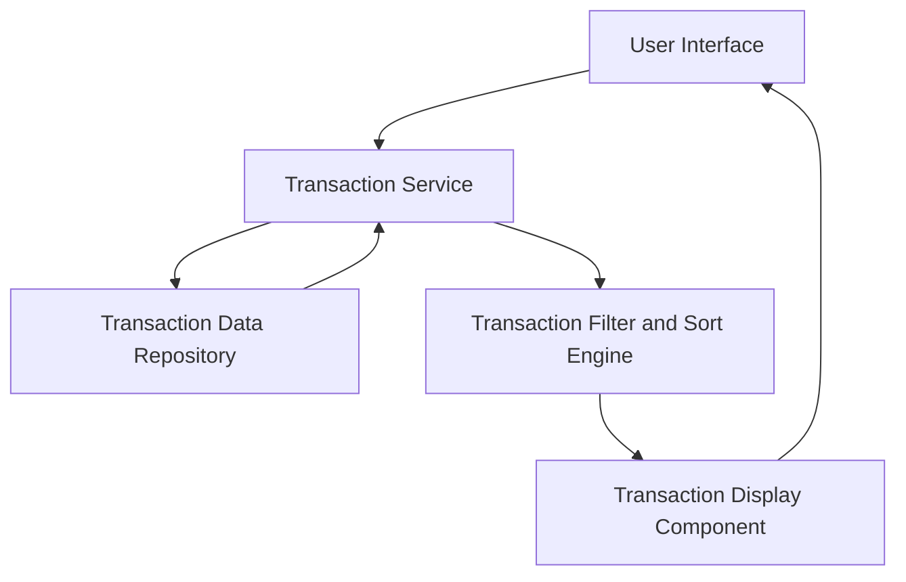

#### 1. High-Level Design

- **Summary:** This epic provides comprehensive transaction monitoring capabilities, enabling users to view and track credit card transactions across all their cards. The core requirement is to display detailed transaction history with the ability to review individual transaction details, supporting users in understanding spending patterns and verifying charges.

- **Component Flow:**

- **Integration Points:** 
  - **Upstream:** Transaction data service or repository for retrieving historical transaction records across all credit cards
  - **Downstream:** Responsive transaction interface with pagination or infinite scroll capabilities for efficient display

- **Key Assumptions:** 
  - Transaction data includes standard fields (date, merchant, amount, category, card identifier, transaction status)
  - Pagination is implemented with default page size of 20-50 transactions per page to optimize performance

- **NFR Highlights:** Transaction list must support pagination or infinite scroll; Response time for transaction retrieval must be under 1 second; System must handle display of large transaction datasets efficiently

- **Data Flow:** User navigates to transaction view → Transaction Service queries Transaction Data Repository for historical records filtered by user's cards → Transaction Filter and Sort Engine applies any user-specified filters (date range, card, amount) and sorting preferences → Transaction Display Component renders paginated list with transaction details → User scrolls or navigates pages to view additional transactions → System loads subsequent pages with sub-1-second response time

#### 2. Validation Report

- **Requirements Coverage:** The design comprehensively addresses the epic's scope including transaction viewing, transaction history display, multi-card transaction support, and responsive transaction interface. All NFRs are covered: efficient handling of large datasets through pagination/infinite scroll, sub-1-second retrieval response time via optimized query design, and performance optimization for large transaction volumes. The dependency on transaction data service is clearly identified and integrated into the architecture.