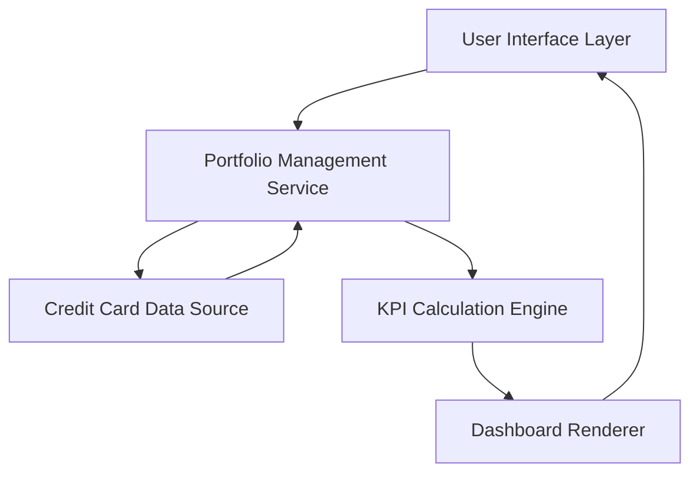

#### 1. High-Level Design

- **Summary:** This epic delivers a consolidated credit card portfolio management interface that displays all user credit cards in a unified dashboard. The core requirement is to provide real-time visibility into key financial metrics (monthly spend, total credit limit, available credit, outstanding amounts) across all cards, enabling users to monitor their overall credit position and make informed financial decisions.

- **Component Flow:**

- **Integration Points:** 
  - **Upstream:** Credit card data source or mock data service for retrieving card information (card details, limits, balances, transactions)
  - **Downstream:** Dashboard UI components for rendering responsive layouts across desktop, tablet, and mobile devices

- **Key Assumptions:** 
  - Credit card data is provided in a standardized JSON/REST API format with fields for card number, limit, available credit, and outstanding balance
  - Real-time data refresh occurs via polling mechanism (e.g., every 30-60 seconds) or push notifications from the data source

- **NFR Highlights:** Dashboard must load and display all KPIs within 2 seconds; System must support responsive layouts across desktop, tablet, and mobile devices; Support for real-time data refresh

- **Data Flow:** User accesses the portfolio dashboard → Portfolio Management Service fetches credit card data from the data source → KPI Calculation Engine aggregates metrics (total credit limit, available credit, outstanding amounts, monthly spend) across all cards → Dashboard Renderer formats and displays the consolidated view with real-time KPIs → User views responsive dashboard on their device with complete portfolio visibility

#### 2. Validation Report

- **Requirements Coverage:** The design fully covers the epic's stated scope including multiple credit card display, dashboard KPIs (Monthly Spend, Total Credit Limit, Available Credit, Outstanding Amount), portfolio overview, and responsive layout. All NFRs regarding responsive design, 2-second load time, and real-time refresh are addressed through the component architecture. The integration dependency with credit card data source is clearly identified and accommodated in the design.