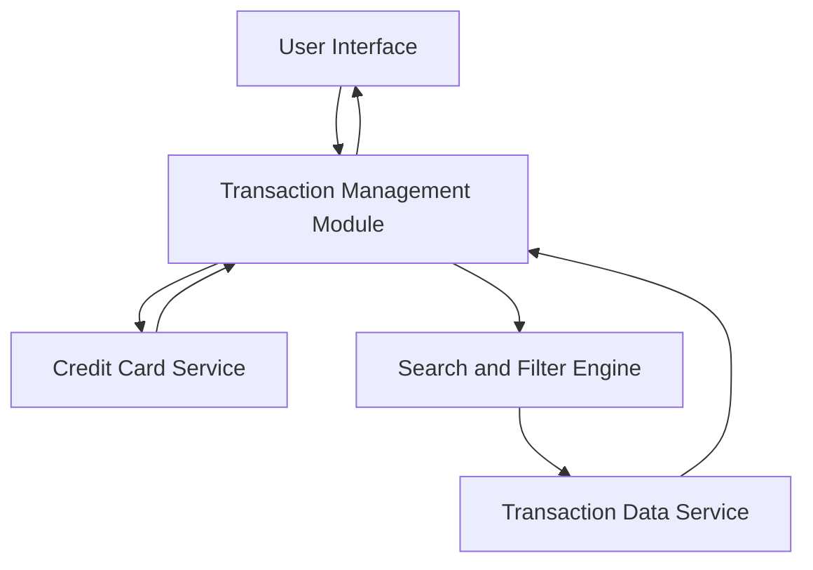

#### 1. High-Level Design

- **Summary:** This epic provides a comprehensive transaction management interface that enables users to view, search, and filter all transactions across their credit cards. Users can access complete transaction history, segregate transactions by card, and quickly locate specific transactions using search and filter capabilities. The solution ensures transparency and helps users maintain financial awareness and detect unauthorized activities.

- **Component Flow:**

- **Integration Points:**
  - **Upstream:** Transaction Data Service (retrieves transaction records with encryption), Credit Card Service (provides card-specific filtering), Date/Time Service (manages transaction timestamps)
  - **Downstream:** User Interface (displays paginated transaction list with search/filter controls)
  - **Internal:** Search and Filter Engine (processes user queries and filter criteria), Transaction Management Module (orchestrates transaction retrieval and presentation)

- **Key Assumptions:** 
  - Transaction data is stored with standardized fields (date, amount, merchant, category, card) to enable consistent filtering and searching.
  - Pagination is server-side to handle large transaction volumes efficiently and meet the 1-second search/filter performance requirement.

- **NFR Highlights:** Pagination support for large datasets; search/filter operations complete within 1 second; handle minimum 10,000 transactions per user; data encrypted at rest and in transit.

- **Data Flow:** User accesses transaction view → Transaction Management Module retrieves paginated transaction list from Transaction Data Service (encrypted in transit) → User applies search/filter criteria → Search and Filter Engine processes query and retrieves filtered results from Transaction Data Service → User selects card-specific filter → Credit Card Service provides card filtering parameters → Filtered and paginated transactions are displayed in User Interface → User can navigate through pages and refine search/filter criteria for detailed transaction monitoring.

#### 2. Validation Report

- **Requirements Coverage:** The design fully satisfies the epic's requirements including transaction listing, comprehensive history access, search functionality, filtering capabilities, and card-wise segregation. All NFRs are addressed: pagination handles large datasets, 1-second search/filter performance through optimized Search and Filter Engine, support for 10,000+ transactions per user via efficient data retrieval, and encryption requirements met through Transaction Data Service security protocols. The architecture supports fraud detection through comprehensive transaction visibility and quick search capabilities.