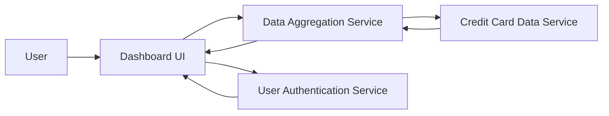

#### 1. High-Level Design

- **Summary:** This epic creates a unified dashboard that aggregates and displays key financial metrics across all user credit cards. The dashboard provides real-time visibility into monthly spend, total credit limit, available credit, and outstanding amounts. It serves as the primary landing page for users to monitor their credit card portfolio health and make informed financial decisions.

- **Component Flow:**

- **Integration Points:**
  - **Upstream:** User Authentication Service (validates user access and identity), Credit Card Data Service (provides card details, balances, and transaction summaries)
  - **Downstream:** Dashboard UI (displays aggregated KPIs in responsive layout)
  - **Internal:** Data Aggregation Service (calculates KPIs across multiple cards)

- **Key Assumptions:** 
  - Credit card data is refreshed in near real-time by the Credit Card Data Service with sufficient frequency to meet the 2-second dashboard load requirement.
  - All financial calculations (credit utilization, available credit) follow standard formulas and are performed by the Data Aggregation Service.

- **NFR Highlights:** Dashboard must load within 2 seconds; real-time data refresh; responsive design for desktop, tablet, mobile; 100% data accuracy for financial calculations.

- **Data Flow:** User authenticates via User Authentication Service → Dashboard UI requests aggregated KPIs from Data Aggregation Service → Service retrieves individual card data from Credit Card Data Service → Service calculates total credit limit, available credit, outstanding amounts, and monthly spend across all cards → Aggregated KPIs are returned to Dashboard UI → Responsive dashboard renders with real-time financial metrics displayed for user review.

#### 2. Validation Report

- **Requirements Coverage:** The design comprehensively addresses all dashboard requirements including KPI display, monthly spend tracking, credit limit aggregation, available credit calculation, outstanding amount tracking, and multiple card views. The responsive layout requirement is met through the Dashboard UI component. All NFRs are addressed: 2-second load time through efficient aggregation, real-time refresh via Credit Card Data Service integration, responsive design support, and 100% accuracy through dedicated financial calculation logic in the Data Aggregation Service.