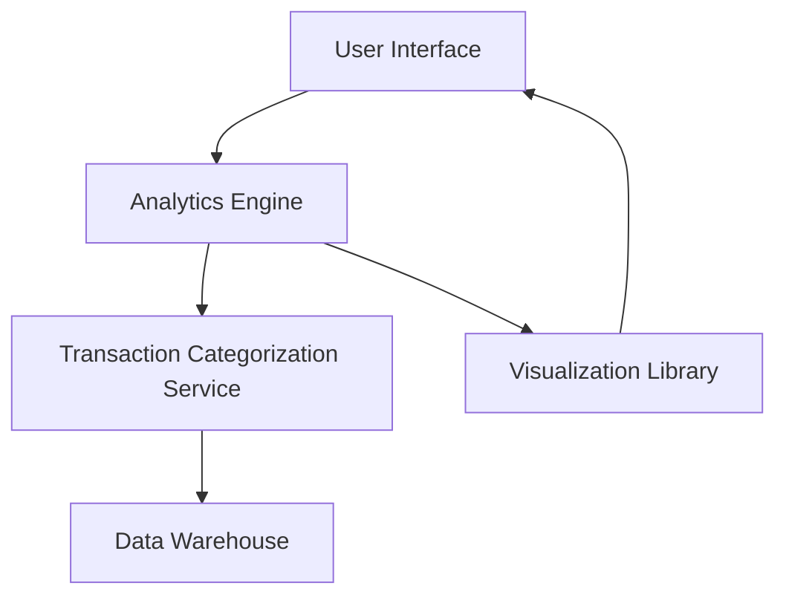

#### 1. High-Level Design

- **Summary:** This epic delivers an interactive analytics module that visualizes user spending patterns across multiple dimensions. Users can view monthly spend trends, analyze spending by predefined categories (Food & Dining, Fuel, Shopping, Travel, Entertainment, Utilities, Healthcare, Education, Miscellaneous), and compare spending across different credit cards. The solution provides actionable insights to help users understand their financial behavior and optimize spending.

- **Component Flow:**

- **Integration Points:**
  - **Upstream:** Transaction Categorization Service (assigns categories to transactions), Data Warehouse (provides historical transaction data for minimum 12 months)
  - **Downstream:** Visualization Library (renders interactive charts and graphs)
  - **Internal:** Analytics Engine (processes and aggregates spending data)

- **Key Assumptions:** 
  - Transaction categorization is performed by an existing service with predefined category mappings; category assignment accuracy is assumed to be handled upstream.
  - Historical data is pre-aggregated in the data warehouse to meet the 3-second aggregation performance requirement.

- **NFR Highlights:** Charts must render within 1.5 seconds; data aggregation must complete within 3 seconds; must support drill-down capabilities; responsive across all devices; handle 12+ months of historical data.

- **Data Flow:** User requests spending analytics → Analytics Engine retrieves categorized transactions from Data Warehouse → Engine aggregates data by time period, category, and card → Processed data is passed to Visualization Library → Interactive charts/graphs are rendered in User Interface → User can drill down into specific categories or time periods for deeper insights.

#### 2. Validation Report

- **Requirements Coverage:** The design fully covers the epic's scope including monthly spend trend visualization, category-wise analysis, card-wise spend analysis, and interactive charts. All specified NFRs (rendering time, drill-down, responsiveness, historical data, aggregation performance) are addressed through appropriate component selection and architecture. The integration with Transaction Categorization Service and Data Warehouse ensures comprehensive spending insights across all predefined categories.