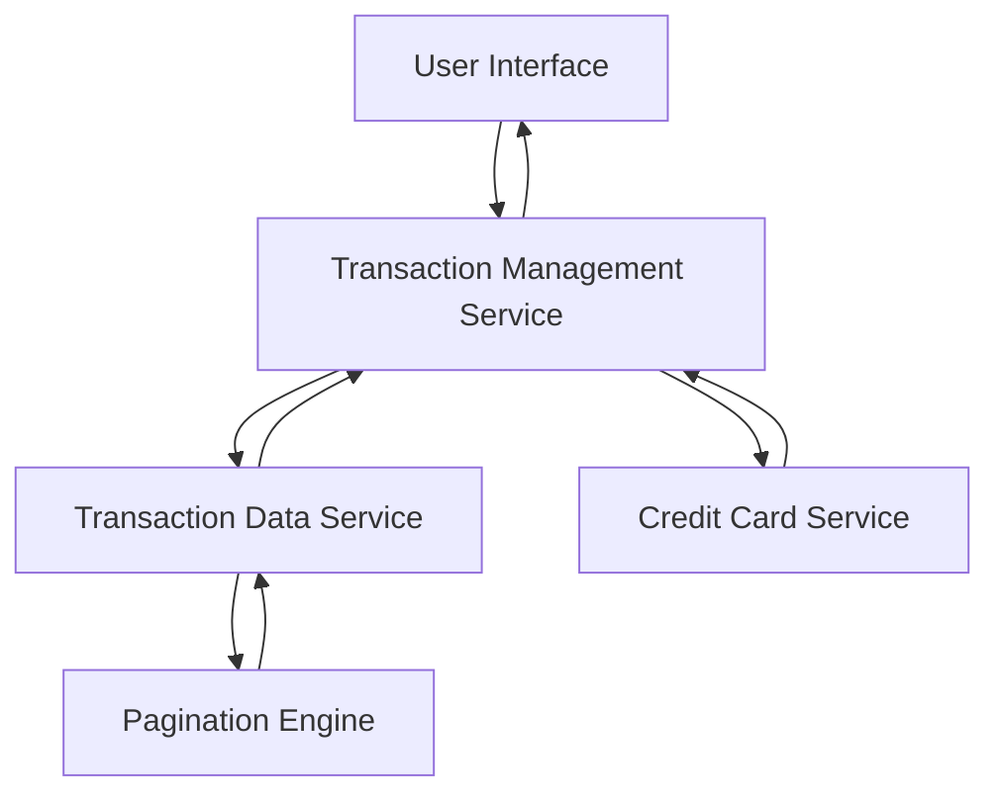

#### 1. High-Level Design

- **Summary:** This epic provides users with comprehensive transaction viewing capabilities, allowing them to track and review all credit card transactions across their portfolio. Users can access detailed transaction history, view transaction details, and monitor spending activity for each card individually or across all cards.

- **Component Flow:**

- **Integration Points:**
  - **Upstream:** Transaction Data Service (retrieves transaction records), Credit Card Service (validates card identification)
  - **Downstream:** Pagination Engine (handles large dataset retrieval efficiently)

- **Key Assumptions:**
  - Transaction data is stored in a centralized repository accessible via Transaction Data Service; historical data retention period is defined by business policy.
  - Pagination is implemented server-side with default page size (e.g., 50 transactions per page) to optimize performance for large datasets.

- **NFR Highlights:** System must handle transaction data retrieval with pagination support for large datasets; Transaction list rendering must complete within 1 second; Support for displaying at least 1000 transactions per card.

- **Data Flow:** User selects a credit card or all cards view → Transaction Management Service validates card access via Credit Card Service → Service queries Transaction Data Service for transaction records → Pagination Engine retrieves data in chunks to handle large datasets efficiently → Transaction records (with details like date, merchant, amount, category) are returned to UI → UI renders transaction listing with filtering options → User can drill down to view detailed transaction information for any selected transaction.

#### 2. Validation Report

- **Requirements Coverage:** The design fully addresses all scope requirements including Transaction listing, Transaction detail view, Card-wise transaction filtering, Transaction history access, and Multi-card transaction aggregation. The architecture integrates with the required Transaction Data Service and Credit Card Service for data retrieval and validation. NFRs for pagination support, sub-1-second rendering, and support for at least 1000 transactions per card are satisfied through the Pagination Engine and efficient data retrieval strategy, ensuring optimal performance for large datasets.