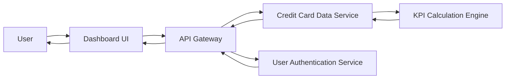

#### 1. High-Level Design

- **Summary:** This epic enables users to view a consolidated dashboard displaying key performance indicators for their credit card portfolio including monthly spend, total credit limit, available credit, and outstanding amounts. Users can monitor multiple credit cards from a single interface with a modern, responsive design that provides real-time visibility into their financial status across all cards.

- **Component Flow:**

- **Integration Points:**
  - **Upstream:** User Authentication Service (provides secure access control), Credit Card Data Service (retrieves card details, balances, and limits)
  - **Downstream:** KPI Calculation Engine (computes aggregated metrics across multiple cards)

- **Key Assumptions:**
  - Credit card data is refreshed in near real-time or at defined intervals (e.g., every 5 minutes) from the Credit Card Data Service.
  - KPI calculations (total credit limit, available credit, outstanding amounts) are performed server-side to ensure consistency across devices.

- **NFR Highlights:** System must support responsive design across desktop, tablet, and mobile devices; Dashboard load time must be under 2 seconds; Support for real-time data refresh.

- **Data Flow:** User authenticates via User Authentication Service → Dashboard UI requests KPI data through API Gateway → API Gateway routes request to Credit Card Data Service → Service retrieves card details, balances, and limits from backend systems → KPI Calculation Engine computes monthly spend, total credit limit, available credit, and outstanding amounts → Aggregated KPIs are returned to Dashboard UI → UI renders consolidated view with real-time visibility across all cards.

#### 2. Validation Report

- **Requirements Coverage:** The design comprehensively covers all scope elements including Dashboard KPIs display, Multiple credit card view, Monthly spend tracking, Total credit limit calculation, Available credit display, Outstanding amount tracking, and Responsive layout implementation. The architecture integrates with the required Credit Card Data Service and User Authentication Service. NFRs for responsive design across devices, sub-2-second load time, and real-time data refresh are addressed through the API Gateway pattern, KPI Calculation Engine, and responsive UI components.