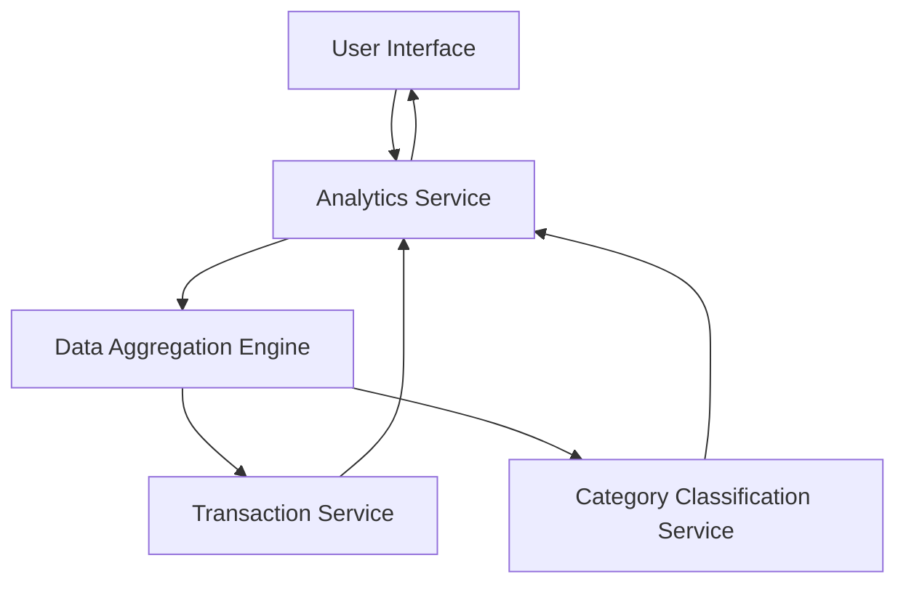

#### 1. High-Level Design

- **Summary:** This epic delivers interactive data visualizations and analytics capabilities that help users understand their spending patterns through category-wise analysis and monthly spend trends. Users can explore spending across predefined categories (Food & Dining, Fuel, Shopping, Travel, Entertainment, Utilities, Healthcare, Education, Miscellaneous) with card-wise spend analysis to identify trends and optimize spending behavior.

- **Component Flow:**

- **Integration Points:**
  - **Upstream:** Transaction service (provides raw spending data), Category classification service (categorizes transactions)
  - **Downstream:** Analytics engine (performs data aggregation and calculation)

- **Key Assumptions:**
  - Transactions are pre-categorized by the Category Classification Service; category mapping is maintained externally.
  - Monthly spend trends are calculated based on transaction date; time zone is assumed to be user's local time or system default.

- **NFR Highlights:** Analytics visualizations must render within 1.5 seconds; System must support interactive filtering and drill-down capabilities; Charts must be responsive and adapt to different screen sizes.

- **Data Flow:** User requests spending analytics → Analytics Service queries Transaction Service for raw transaction data → Data Aggregation Engine processes and groups transactions by category and time period → Category Classification Service validates/enriches category data → Aggregated results are formatted and returned to UI → Interactive charts and graphs render spending patterns, trends, and category breakdowns for user analysis.

#### 2. Validation Report

- **Requirements Coverage:** The design covers all stated scope items including category-wise spending visualization, monthly spend trend analysis, card-wise spend analysis, interactive charts and graphs, spending pattern identification, and multi-category breakdown. The architecture supports the required integrations with analytics engine, transaction service, and category classification service. NFRs for rendering performance (1.5 seconds), interactive filtering, and responsive design are addressed through the component separation and data aggregation approach.