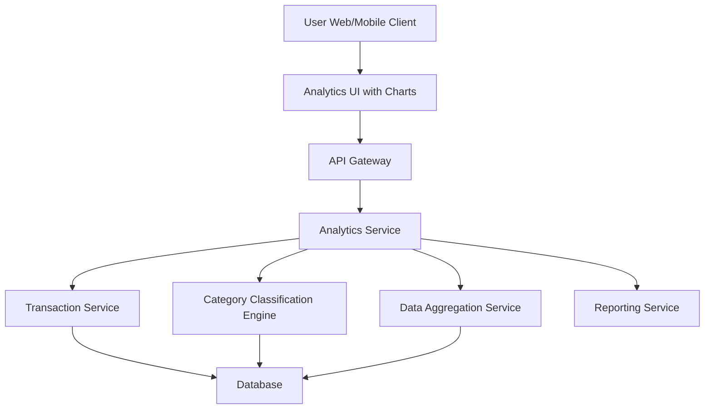

#### 1. High-Level Design

- **Summary:** This epic delivers comprehensive analytics and visualization capabilities enabling users to understand spending patterns through interactive charts and category-wise breakdowns. Users can analyze monthly spend trends over time and view detailed spending across nine predefined categories (Food & Dining, Fuel, Shopping, Travel, Entertainment, Utilities, Healthcare, Education, Miscellaneous). The analytics provide actionable insights for budget optimization and spending behavior identification.

- **Component Flow:**

- **Integration Points:** 
  - **Upstream:** Transaction Service (for raw transaction data)
  - **Downstream:** Category Classification Engine (for transaction categorization), Data Aggregation Service (for trend calculations and time-series aggregation), Reporting Service (for data export functionality)

- **Key Assumptions:** 
  - Transactions are either pre-categorized or classified in real-time by Category Classification Engine using predefined rules or ML models; categories are limited to the nine specified categories plus Miscellaneous.
  - Monthly trend data is aggregated and stored for at least 12 months; data export supports common formats (CSV, PDF).

- **NFR Highlights:** Visualizations must render within 1.5 seconds; charts must be interactive and responsive; system must handle minimum 12 months of historical trend data; category calculations must be accurate and real-time; analytics must support data export functionality.

- **Data Flow:** User accesses Analytics UI → Analytics Service retrieves transaction data from Transaction Service → Transactions are processed by Category Classification Engine to assign categories → Data Aggregation Service computes monthly spend trends and category-wise totals → Aggregated data is formatted for visualization → Interactive charts and category breakdowns are rendered in Analytics UI (within 1.5 seconds) → User interacts with visualizations to explore spending patterns → User can export analytics data via Reporting Service.

#### 2. Validation Report

- **Requirements Coverage:** The design fully covers the epic's scope including monthly spend trends visualization, category-wise spending analysis across all nine specified categories (Food & Dining, Fuel, Shopping, Travel, Entertainment, Utilities, Healthcare, Education, Miscellaneous), interactive charts and graphs, and spending pattern identification. The architecture supports all NFRs: 1.5-second rendering, interactive and responsive charts, 12 months of historical data, accurate and real-time category calculations, and data export functionality. All integration dependencies (Transaction Service, Category Classification Engine, Data Aggregation Service, Reporting Service) are explicitly addressed in the component flow and data flow.