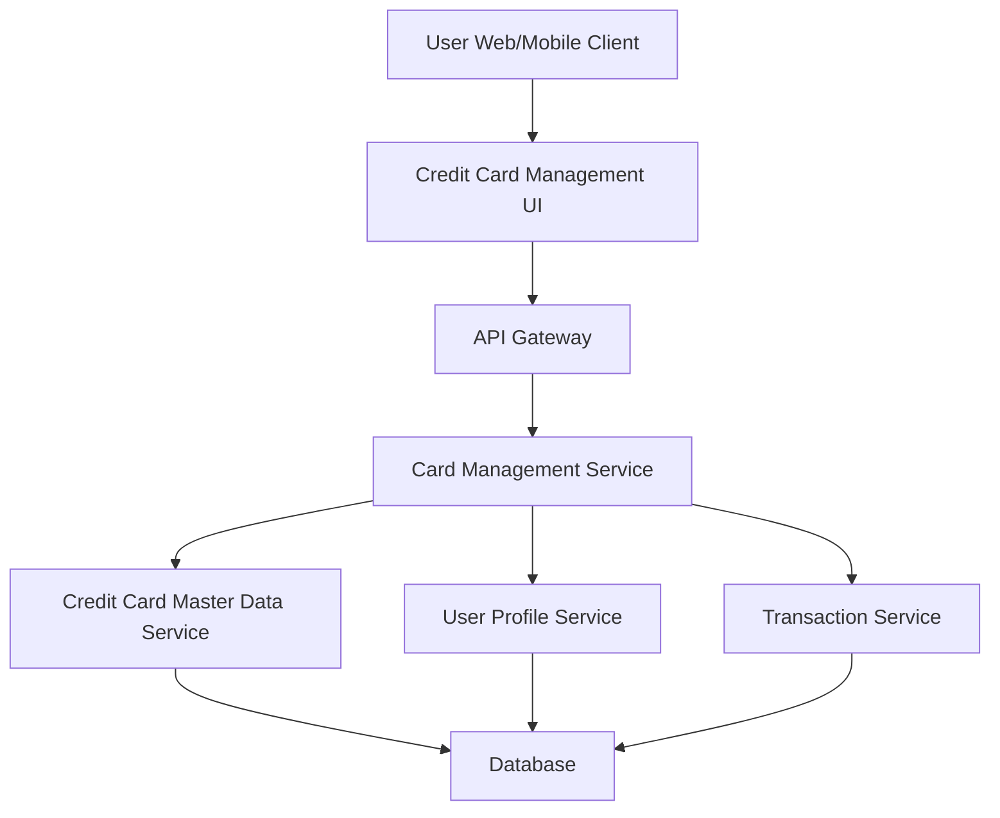

#### 1. High-Level Design

- **Summary:** This epic enables users to view, manage, and monitor multiple credit cards from a unified interface. Users can see all their credit cards with relevant details, track individual card spending, and understand card-wise financial positions including credit limit, available credit, outstanding balance, and usage patterns. The feature supports informed decision-making for card usage optimization and credit portfolio management.

- **Component Flow:**

- **Integration Points:** 
  - **Upstream:** User Profile Service (for user-card associations and user identity)
  - **Downstream:** Credit Card Master Data Service (for card master data and limits), Transaction Service (for card-wise spending data and transaction history)

- **Key Assumptions:** 
  - User-card associations are pre-established in User Profile Service; card data is maintained in a centralized Credit Card Master Data Service.
  - Card-wise spending is calculated by aggregating transactions filtered by card identifier; card status indicators reflect operational status (active/inactive/blocked).

- **NFR Highlights:** System must support minimum 10 credit cards per user; card data retrieval must complete within 1 second; interface must be responsive and accessible; data accuracy maintained across all card calculations.

- **Data Flow:** User accesses Credit Card Management UI → Card Management Service retrieves user's associated cards from User Profile Service → For each card, service fetches card details from Credit Card Master Data Service and card-wise transaction data from Transaction Service → Service aggregates data to compute card-wise metrics (spending, outstanding balance, available credit, usage patterns) → Consolidated multi-card view with individual card details is presented to user → User can filter, select, and drill down into specific card details.

#### 2. Validation Report

- **Requirements Coverage:** The design comprehensively covers the epic's scope including multiple credit card display interface, card-wise spend analysis, individual card details view, card selection and filtering, card status indicators, card-wise credit limit tracking, and outstanding balance display. The architecture supports NFRs for minimum 10 cards per user, 1-second data retrieval, responsive interface, and data accuracy. All integration dependencies (Credit Card Master Data Service, User Profile Service, Transaction Service) are explicitly addressed in the component flow and data flow.