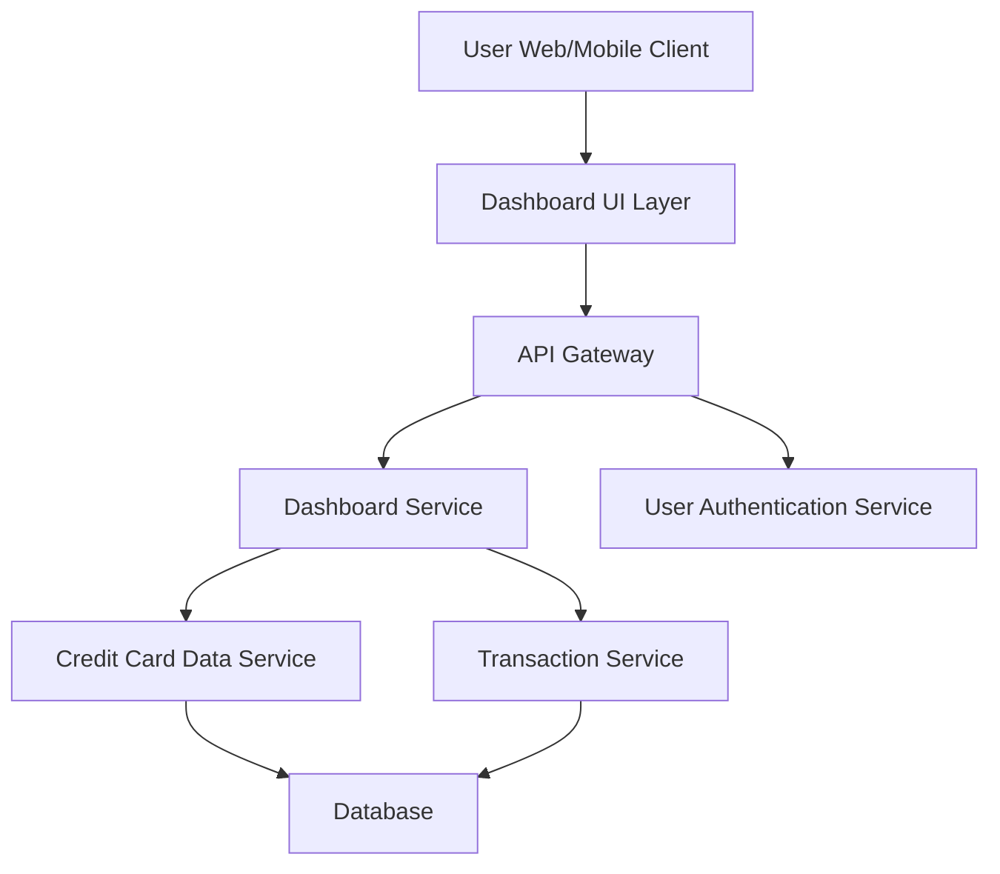

#### 1. High-Level Design

- **Summary:** This epic delivers a responsive dashboard providing real-time visibility into credit card financial health through key performance indicators (KPIs). The dashboard consolidates critical metrics—Monthly Spend, Total Credit Limit, Available Credit, and Outstanding Amount—across all user credit cards, enabling users to monitor their overall financial position and make informed credit management decisions.

- **Component Flow:**

- **Integration Points:** 
  - **Upstream:** User Authentication Service (for secure access and user identity)
  - **Downstream:** Credit Card Data Service (for card details and credit limits), Transaction Service (for spending calculations and transaction data)

- **Key Assumptions:** 
  - Monthly Spend is calculated based on the current calendar month; transactions are pre-categorized and stored in the Transaction Service.
  - KPI refresh occurs on page load or user-triggered refresh; real-time updates assume near-real-time data availability from backend services.

- **NFR Highlights:** Dashboard must be responsive across desktop, tablet, and mobile devices; page load time under 2 seconds; KPI calculations accurate to 2 decimal places; support concurrent viewing by multiple users.

- **Data Flow:** User authenticates via Authentication Service → Dashboard Service fetches user's credit card details from Credit Card Data Service and transaction data from Transaction Service → Dashboard Service aggregates data to compute KPIs (Monthly Spend, Total Credit Limit, Available Credit, Outstanding Amount) → Computed KPIs are returned to Dashboard UI Layer → User views consolidated financial metrics in real-time on responsive interface.

#### 2. Validation Report

- **Requirements Coverage:** The design fully covers the epic's stated scope including dashboard interface, all four KPI displays (Monthly Spend, Total Credit Limit, Available Credit, Outstanding Amount), responsive layout, and real-time data refresh. The architecture supports the NFRs for responsiveness, performance (2-second load time), accuracy (2 decimal places), and concurrent user access. Integration dependencies with Credit Card Data Service, Transaction Service, and User Authentication Service are explicitly addressed in the component flow.