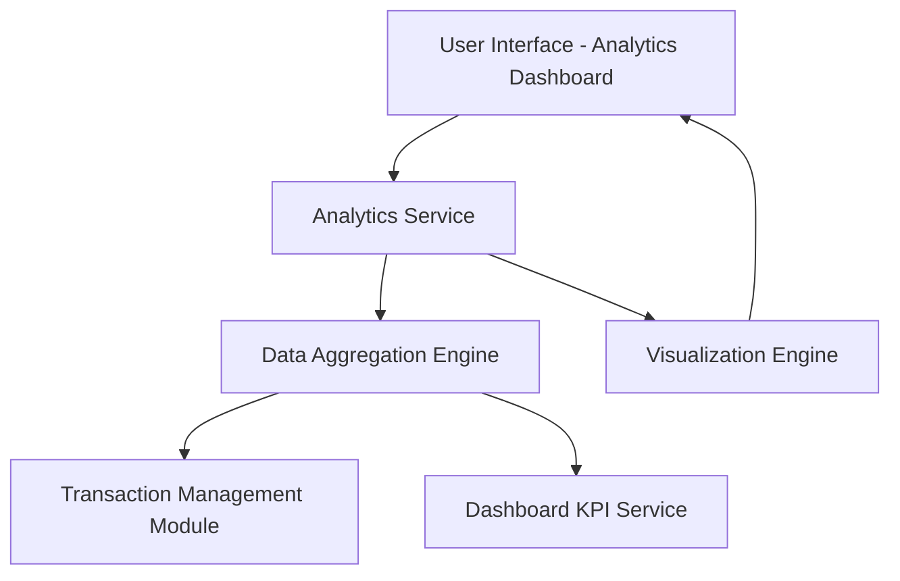

#### 1. High-Level Design

- **Summary:** This epic delivers interactive analytics and visualization capabilities that enable users to understand spending patterns through category-wise analysis and monthly trends. Users can explore spending across 9 predefined categories (Food & Dining, Fuel, Shopping, Travel, Entertainment, Utilities, Healthcare, Education, Miscellaneous) with card-wise comparisons and historical trend analysis supporting data-driven financial planning.

- **Component Flow:**

- **Integration Points:** 
  - **Upstream:** Transaction Management Module for detailed transaction data; Dashboard KPI Service for aggregated spending metrics
  - **Downstream:** May integrate with charting library (e.g., Chart.js, D3.js, or similar) for interactive visualizations

- **Key Assumptions:** 
  - Transactions are pre-categorized into the 9 defined categories; if not, a categorization service maps merchants to categories
  - Analytics data is aggregated and cached for 12 months of historical data; visualizations are generated on-demand with client-side rendering for interactivity

- **NFR Highlights:** Interactive and responsive visualizations, chart rendering within 1 second, support 12 months of historical data, adaptive to different screen sizes

- **Data Flow:** User accesses analytics dashboard → Analytics Service requests transaction data from Transaction Management Module and aggregated metrics from Dashboard KPI Service → Data Aggregation Engine processes transactions by category, card, and time period (monthly) for up to 12 months → Aggregated data is passed to Visualization Engine → Visualization Engine generates interactive charts (category-wise pie/bar charts, monthly trend line charts, card-wise comparison) → Charts are rendered in UI within 1 second → User interacts with visualizations (filter by date range, card, category) → Analytics Service updates aggregations and refreshes visualizations dynamically

#### 2. Validation Report

- **Requirements Coverage:** The design fully addresses the epic's scope including category-wise spending visualization, monthly spend trends analysis, card-wise spend analysis, interactive charts, and spending pattern identification across all 9 specified categories. The Data Aggregation Engine ensures efficient processing of 12 months of historical data, and the Visualization Engine meets the 1-second rendering NFR with responsive, interactive charts. Integration dependencies with Transaction Management and Dashboard KPI modules are clearly defined, and the architecture supports adaptive visualizations across different screen sizes. The design excludes out-of-scope items (predictive analytics, budget alerts, AI insights, external exports) as specified.