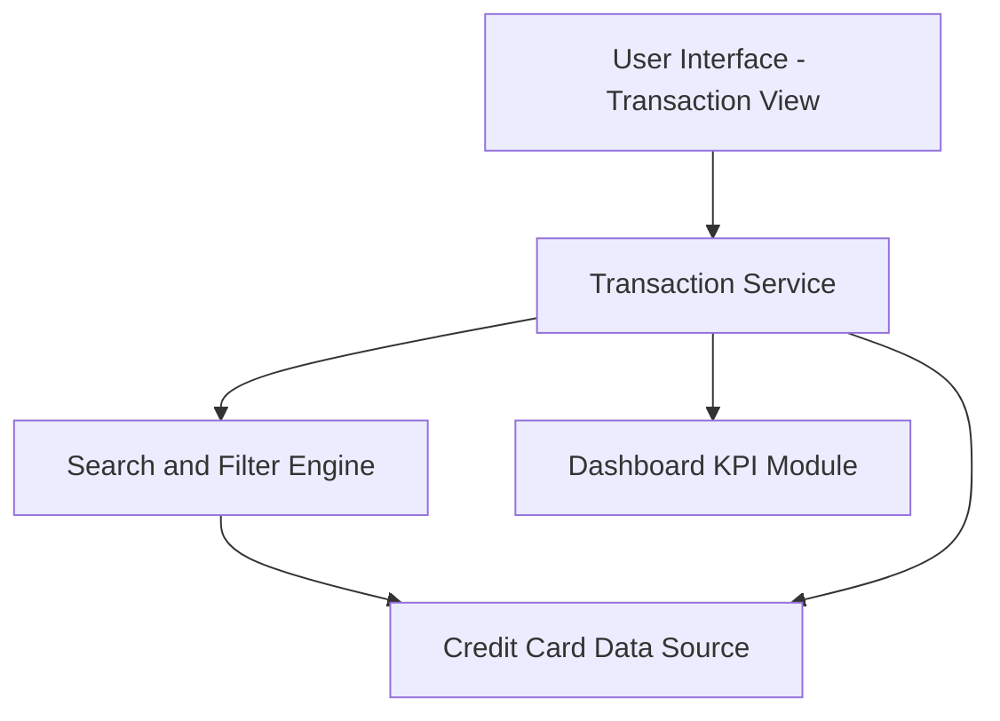

#### 1. High-Level Design

- **Summary:** This epic provides comprehensive transaction viewing and management capabilities across all user credit cards. Users can access detailed transaction histories, apply filters and search, and gain insights into spending activities. The module serves as the foundational data layer for understanding spending patterns and tracking expenditures across multiple cards.

- **Component Flow:**

- **Integration Points:** 
  - **Upstream:** Credit card data source for transaction records (date, amount, merchant, category, card ID)
  - **Downstream:** Provides transaction data to Dashboard KPI module for spend calculations and to Analytics module for category-wise analysis

- **Key Assumptions:** 
  - Transactions are stored with standard attributes (transaction ID, date, amount, merchant, category, card ID, status)
  - Search and filter operations are optimized with indexing on date, amount, and category fields to meet 500ms performance requirement

- **NFR Highlights:** System must handle up to 1000 transactions per user efficiently, responsive layout, search/filter operations complete within 500ms

- **Data Flow:** User navigates to transaction view → Transaction Service retrieves transaction records from Credit Card Data Source → User applies filters/search → Search and Filter Engine processes criteria and returns filtered results within 500ms → Transaction Service formats and returns transaction list to UI → UI displays paginated transaction history with details (date, merchant, amount, category, card) → Transaction data is also sent to Dashboard KPI Module for aggregated spend metrics

#### 2. Validation Report

- **Requirements Coverage:** The design comprehensively addresses the epic's scope including transaction listing, viewing, multi-card aggregation, history access, and detail display. The Search and Filter Engine ensures efficient query performance meeting the 500ms NFR. Integration with the credit card data source is defined for transaction retrieval, and the connection to the Dashboard KPI module ensures consistent spend calculations. The architecture supports handling 1000 transactions per user with responsive presentation across devices.