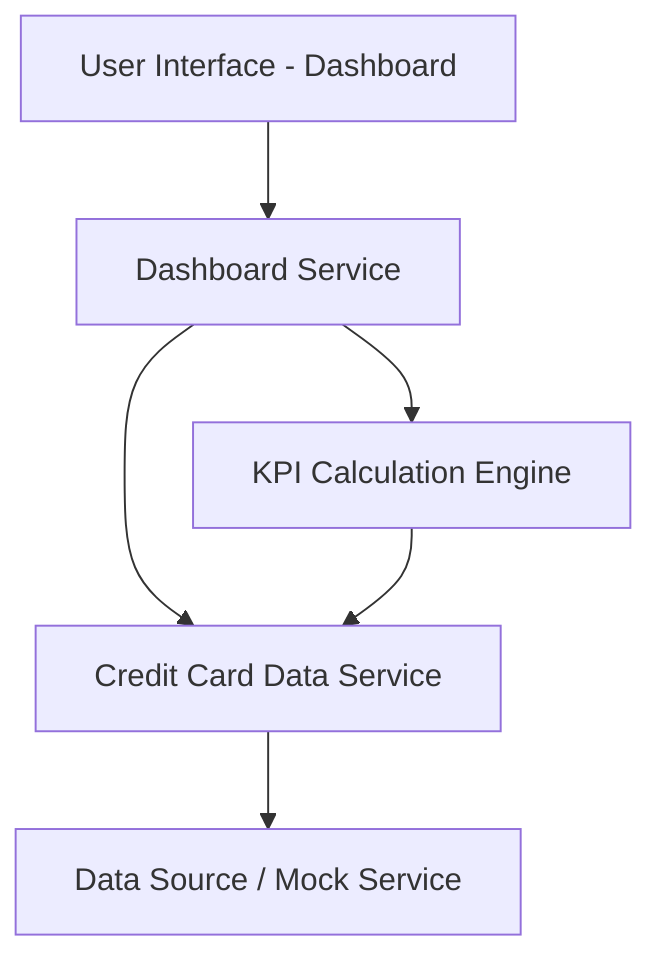

#### 1. High-Level Design

- **Summary:** This epic delivers a consolidated dashboard that aggregates and displays key performance indicators (KPIs) for all user credit cards. The dashboard shows monthly spend, total credit limit, available credit, and outstanding amounts, providing users with a comprehensive view of their credit card portfolio to support proactive financial management and prevent credit over-utilization.

- **Component Flow:**

- **Integration Points:** 
  - **Upstream:** Credit card data source or mock data service for card details, balances, limits, and transaction information
  - **Downstream:** Provides aggregated KPI data to the Transaction Management module for spend calculations

- **Key Assumptions:** 
  - Credit card data is available in a structured format (JSON/REST API) with fields for card ID, limit, balance, and monthly spend
  - KPI calculations are performed server-side and cached for performance; dashboard refreshes data on user request or at defined intervals

- **NFR Highlights:** Dashboard must be responsive (desktop/tablet/mobile), page load under 2 seconds, support up to 10 concurrent credit cards per user

- **Data Flow:** User accesses the dashboard → Dashboard Service requests card data from Credit Card Data Service → Data Service fetches card details and transaction summaries from Data Source/Mock Service → KPI Calculation Engine computes monthly spend, total limit, available credit, and outstanding amounts → Aggregated KPIs are returned to Dashboard Service → Dashboard UI renders the consolidated view with all metrics for user review

#### 2. Validation Report

- **Requirements Coverage:** The design fully covers the epic's stated scope including dashboard KPI display, monthly spend tracking, total credit limit aggregation, available credit calculation, outstanding amount visibility, and multi-card consolidated view. The component architecture supports responsive design and performance requirements (sub-2-second load time). Integration with credit card data source is clearly defined, and the KPI calculation engine ensures accurate metric computation for up to 10 cards per user.