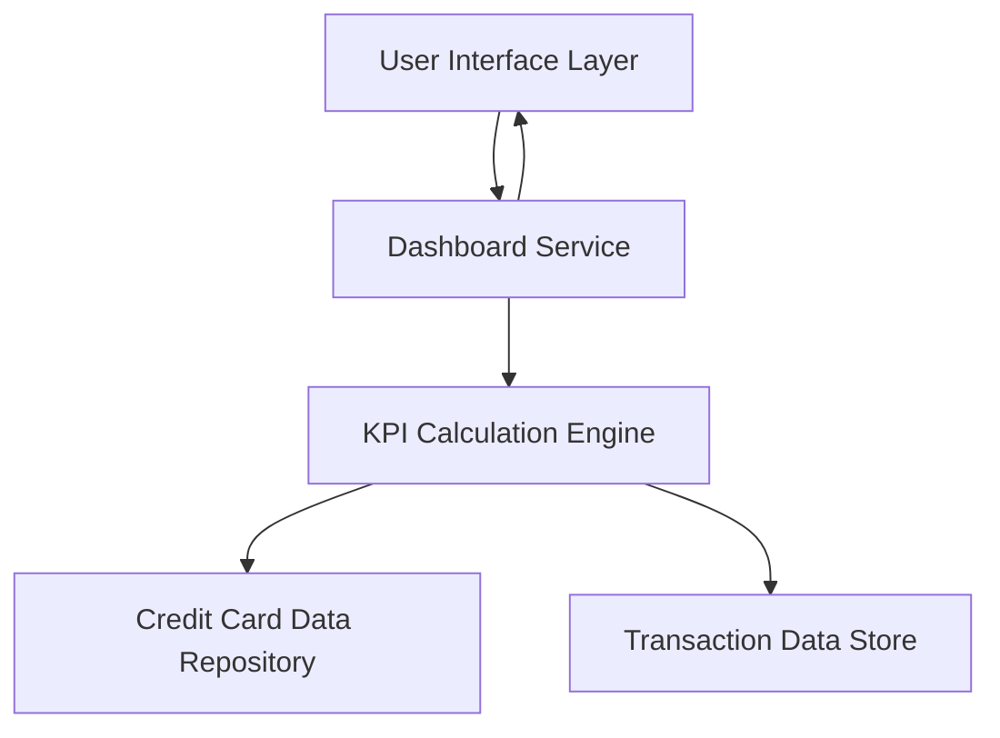

#### 1. High-Level Design

- **Summary:** This epic delivers a consolidated dashboard that displays key performance indicators (KPIs) for users' credit card portfolios. The dashboard provides real-time visibility into monthly spend, total credit limit, available credit, and outstanding amounts across all credit cards through a responsive, modern interface.

- **Component Flow:**

- **Integration Points:** 
  - **Upstream:** Credit card data source/database for card information, transaction data, and balance information
  - **Downstream:** Responsive UI rendering across desktop, tablet, and mobile devices

- **Key Assumptions:** 
  - KPI calculations (available credit, outstanding amounts) are derived from real-time or near-real-time data feeds from the credit card data repository
  - Dashboard refresh frequency is event-driven or polling-based with acceptable latency for "real-time" user experience

- **NFR Highlights:** Dashboard must be responsive across desktop, tablet, and mobile devices; page load time must be optimized for quick access; UI must support real-time data refresh

#### 2. Validation Report

- **Requirements Coverage:** The design covers all stated scope elements including dashboard interface, KPI displays (monthly spend, total credit limit, available credit, outstanding amount), responsive layout, and multi-card consolidated view. The component flow addresses the need for data aggregation from credit card and transaction data sources, calculation of KPIs, and presentation through a responsive UI layer.