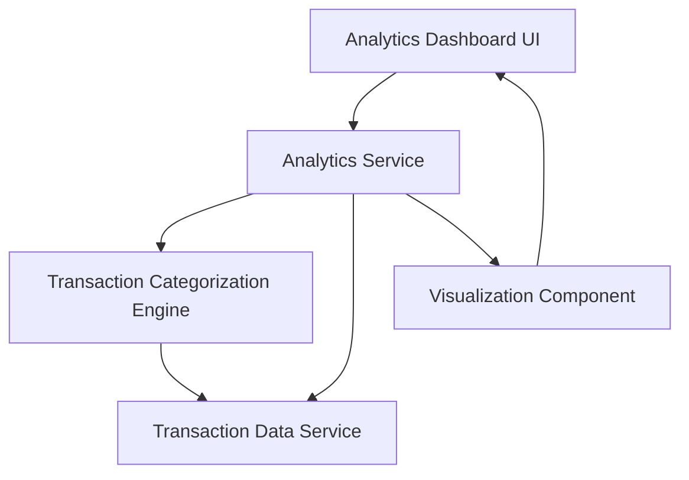

#### 1. High-Level Design

- **Summary:** This epic provides comprehensive spending analytics through interactive visualizations that help users understand spending patterns. Users can analyze expenses across 9 predefined categories (Food & Dining, Fuel, Shopping, Travel, Entertainment, Utilities, Healthcare, Education, Miscellaneous) with monthly spend trend analysis and category-wise breakdowns for informed financial decision-making.

- **Component Flow:**

- **Integration Points:** 
  - **Upstream:** Transaction data service for accessing historical and current transactions
  - **Upstream:** Categorization engine or logic for classifying transactions into 9 predefined spending categories
  - **Downstream:** Interactive visualization components rendering charts and analytics reports

- **Key Assumptions:** 
  - Transaction categorization is either automated via rules/ML or manually tagged; categorization logic is deterministic and consistent
  - Monthly trend analysis covers a default time period (e.g., last 12 months) unless otherwise specified by user filters

- **NFR Highlights:** Analytics must process and display data for large transaction volumes efficiently; visualizations must be interactive and responsive; category calculations must be accurate and real-time; charts must render quickly even with historical data

#### 2. Validation Report

- **Requirements Coverage:** The design comprehensively covers all scope elements including category-wise spending visualization, monthly spend trend charts, interactive analytics dashboard, spending pattern analysis across 9 predefined categories, transaction categorization, spend analysis reports, and data visualization components. The architecture supports efficient processing of large transaction volumes with real-time accuracy and responsive rendering.