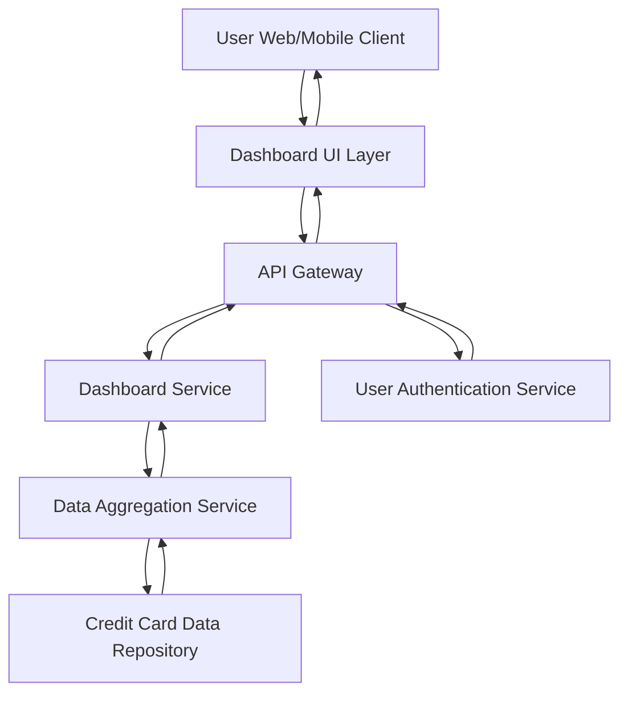

#### 1. High-Level Design

- **Summary:** This epic delivers a centralized dashboard that provides real-time visibility into a user's credit card portfolio. The dashboard displays key financial metrics (monthly spend, total credit limit, available credit, outstanding amounts) across all credit cards in a consolidated, responsive interface. Users can quickly assess their financial position and credit utilization without navigating multiple sources.

- **Component Flow:**

- **Integration Points:** 
  - **Upstream:** User Authentication Service (for secure access and user identity verification)
  - **Data Source:** Credit Card Data Repository (provides card details, limits, balances, and transaction summaries)
  - **Internal:** Data Aggregation Service (consolidates multi-card data for unified view)

- **Key Assumptions:** 
  - Credit card data is available in a structured format (JSON/API) from the data repository with fields for limit, balance, and monthly spend pre-calculated.
  - Real-time synchronization refers to data refresh frequency of 5-15 minutes, not true sub-second real-time streaming.

- **NFR Highlights:** Dashboard must load within 2 seconds for up to 10 credit cards per user, support responsive design for mobile and desktop, ensure data accuracy with real-time synchronization.

- **Data Flow:** User authenticates via the Authentication Service. Upon successful login, the Dashboard Service requests aggregated credit card data from the Data Aggregation Service, which queries the Credit Card Data Repository for all cards associated with the user. The repository returns card-level details (credit limit, outstanding balance, available credit, monthly spend). The Data Aggregation Service consolidates this information and returns it to the Dashboard Service, which formats the data into KPIs. The Dashboard UI Layer renders the KPIs and card overview in a responsive layout, displaying monthly spend, total credit limit, available credit, and outstanding amounts to the user.

#### 2. Validation Report

- **Requirements Coverage:** The design fully covers the epic's stated scope including monthly spend display, total credit limit tracking, available credit calculation, outstanding amount monitoring, multi-card consolidated view, responsive dashboard layout, and KPI visualization. All NFRs (2-second load time, responsive design, data accuracy) are addressed through the Data Aggregation Service and optimized API Gateway. Dependencies on User Authentication Service, Credit Card Data Repository, and Data Aggregation Service are explicitly integrated. Out-of-scope items (real bank integration, payments, fund transfers, loans, payment gateway) are correctly excluded from the design.