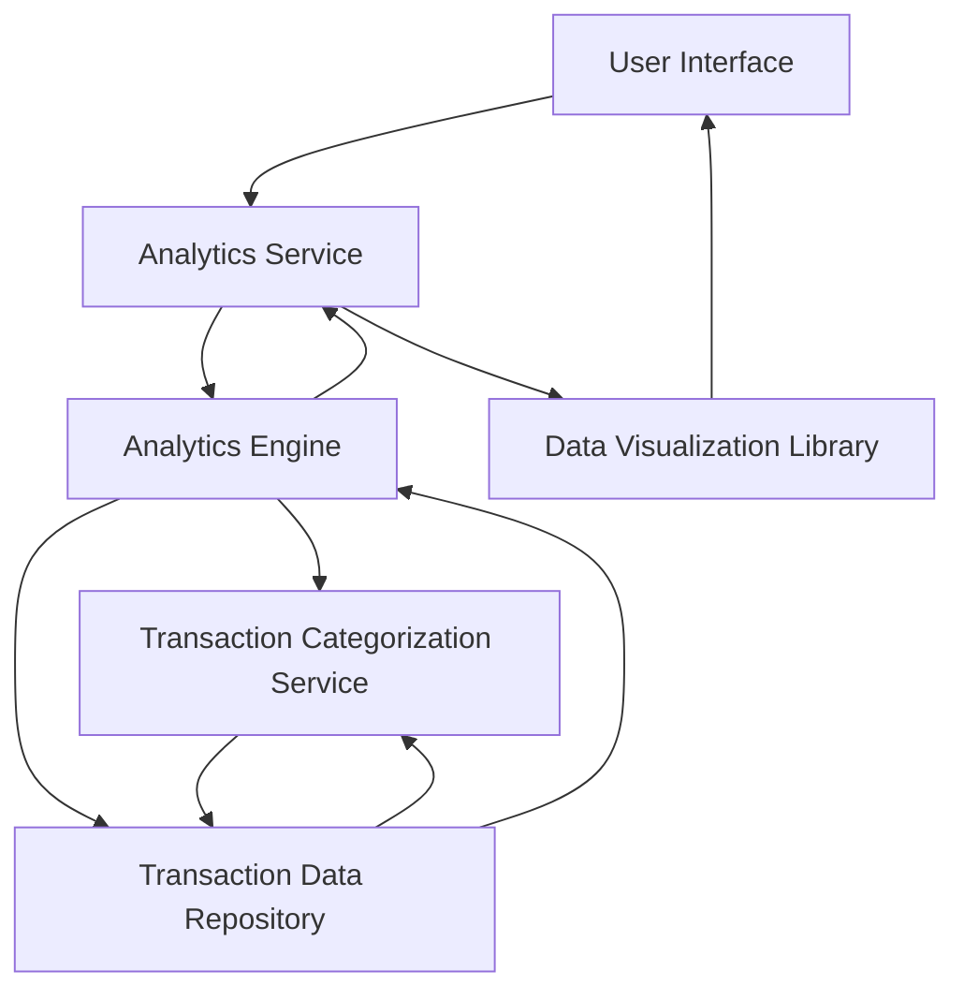

#### 1. High-Level Design

- **Summary:** This epic provides interactive spending analytics and visualizations to help users understand their spending patterns. Users can view monthly spend trends, card-wise spending distribution, and category-wise breakdowns across nine predefined categories (Food & Dining, Fuel, Shopping, Travel, Entertainment, Utilities, Healthcare, Education, Miscellaneous). The system aggregates at least 12 months of historical data and renders interactive charts.

- **Component Flow:**

- **Integration Points:**
  - **Upstream:** User Authentication Service (implied for secure access)
  - **Downstream:** Transaction Categorization Service (for mapping transactions to spending categories), Analytics Engine (for aggregating and computing spending metrics), Transaction Data Repository (for historical transaction data), Data Visualization Library (for rendering interactive charts)

- **Key Assumptions:**
  - Transactions are automatically categorized by the Transaction Categorization Service using predefined rules or machine learning models.
  - Category mappings are maintained and updated independently of this epic.

- **NFR Highlights:** Analytics visualizations must be interactive and responsive; charts must render within 2 seconds; system must support data aggregation for at least 12 months of historical data.

- **Data Flow:** User accesses the analytics interface. The Analytics Service requests aggregated spending data from the Analytics Engine, which retrieves transaction records from the Transaction Data Repository. The Transaction Categorization Service maps transactions to predefined categories (Food & Dining, Fuel, Shopping, etc.). The Analytics Engine computes metrics for monthly trends, card-wise distribution, and category-wise breakdowns. Aggregated data is returned to the Analytics Service, which uses the Data Visualization Library to render interactive charts and graphs displayed in the UI.

#### 2. Validation Report

- **Requirements Coverage:** The design fully addresses the epic's scope, including monthly spend trends, card-wise spend analysis, category-wise analytics for all nine categories, and interactive charts. The architecture supports the NFRs for interactive/responsive visualizations, 2-second chart rendering, and 12-month historical data aggregation. All dependencies (Transaction Categorization Service, Analytics Engine, Data Visualization Library) are incorporated into the component flow.