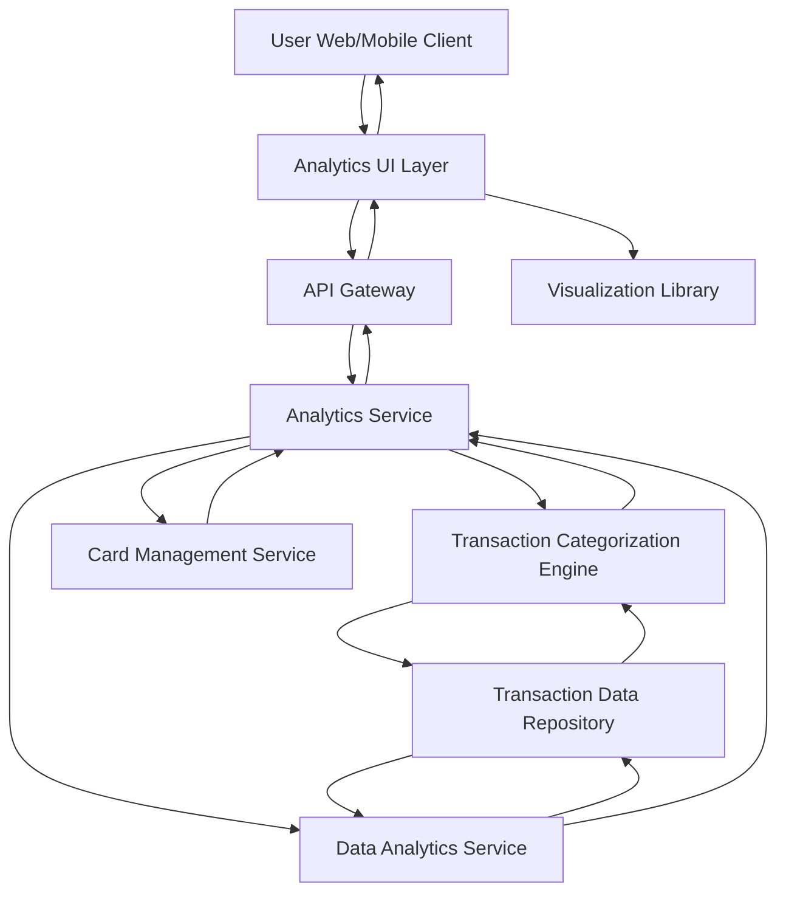

#### 1. High-Level Design

- **Summary:** This epic delivers interactive analytics and visualization capabilities that help users understand spending patterns through category-wise analysis and monthly spend trends. Users can explore spending across 9 predefined categories (Food & Dining, Fuel, Shopping, Travel, Entertainment, Utilities, Healthcare, Education, Miscellaneous), view card-wise spend comparisons, and analyze historical data to identify patterns and optimize budget allocation.

- **Component Flow:**

- **Integration Points:** 
  - **Upstream:** Transaction Data Repository (provides raw transaction data for analysis)
  - **Internal:** Transaction Categorization Engine (categorizes transactions into predefined categories)
  - **Internal:** Data Analytics Service (performs aggregation, trend analysis, and statistical computations)
  - **Internal:** Card Management Service (provides card metadata for card-wise analysis)
  - **Frontend:** Visualization Library (renders interactive charts and graphs)

- **Key Assumptions:** 
  - Transaction categorization is automated using merchant codes or merchant name matching, with a fallback to "Miscellaneous" for unclassified transactions.
  - Historical data for at least 12 months is available and accessible with acceptable performance for trend analysis.

- **NFR Highlights:** Analytics visualizations must render within 3 seconds, support interactive filtering and drill-down capabilities, handle historical data for at least 12 months, ensure accurate categorization of transactions.

- **Data Flow:** User requests spending analytics via the Analytics UI Layer. The API Gateway routes the request to the Analytics Service, which coordinates multiple operations: (1) The Transaction Categorization Engine retrieves transactions from the Transaction Data Repository and categorizes them into 9 predefined categories using merchant data. (2) The Data Analytics Service performs aggregations (category-wise totals, monthly trends, card-wise comparisons) on categorized transaction data. (3) The Card Management Service provides card metadata for card-wise spend analysis. (4) The Analytics Service consolidates the results and returns structured data to the UI. (5) The Visualization Library (frontend) renders interactive charts and graphs showing category-wise spending breakdown, monthly spend trends, and card-wise comparisons. Users can apply filters (date range, card, category) and drill down into specific categories, triggering new analytics queries with sub-3-second rendering time.

#### 2. Validation Report

- **Requirements Coverage:** The design fully addresses the epic's scope including category-wise spending visualization (9 categories), monthly spend trend analysis, card-wise spend comparison, interactive charts and graphs, spending pattern identification, multi-category breakdown, and historical spending data analysis. All NFRs are covered: 3-second rendering time through optimized analytics queries, interactive filtering and drill-down via the Analytics Service, 12-month historical data support, and accurate categorization via the Transaction Categorization Engine. All dependencies (Transaction Categorization Engine, Data Analytics Service, Visualization Library, Transaction Data Repository, Card Management Service) are integrated. Out-of-scope items (real bank integration, predictive forecasts, budget alerts, spending recommendations, loans analysis) are correctly excluded from the design.