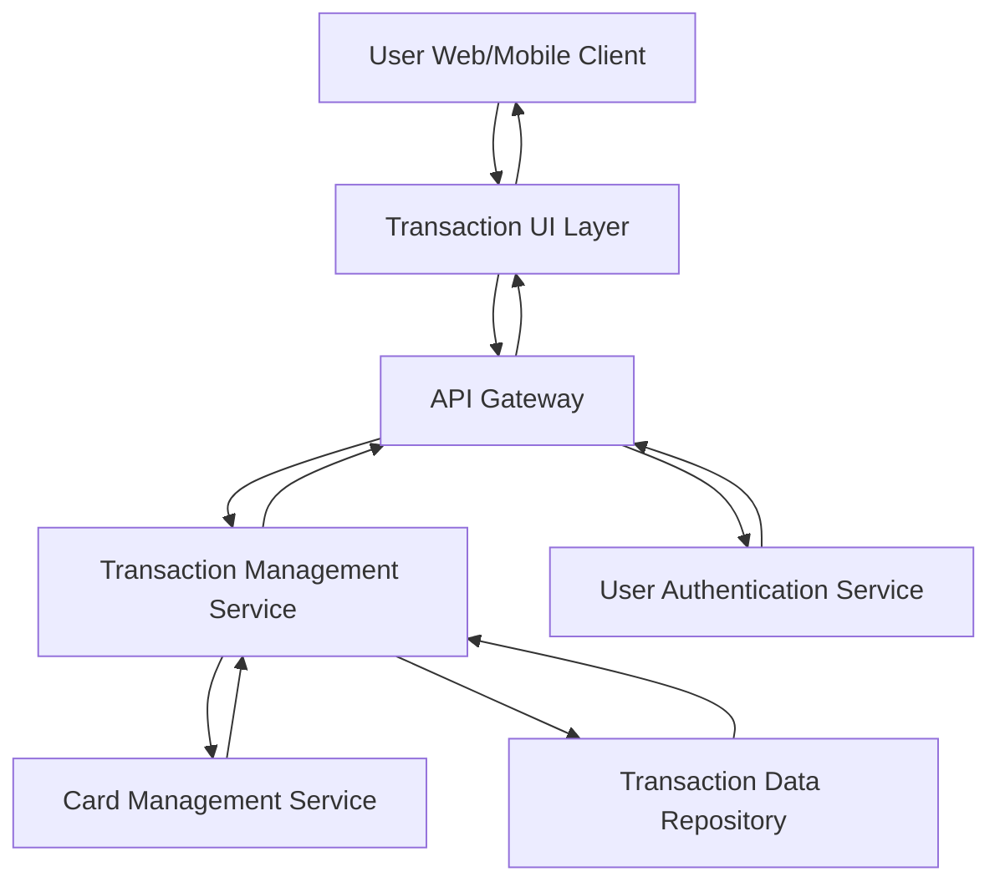

#### 1. High-Level Design

- **Summary:** This epic enables users to view, track, and manage credit card transactions across all registered cards. Users access detailed transaction histories with filtering and search capabilities, supporting spending analysis, financial planning, and verification of charges. The system provides card-wise transaction segregation and multi-card transaction aggregation in a unified interface.

- **Component Flow:**

- **Integration Points:** 
  - **Upstream:** User Authentication Service (for secure transaction access)
  - **Data Source:** Credit Card Transaction Data Source / Transaction Data Repository (provides transaction records)
  - **Internal:** Card Management Service (provides card metadata and user-card associations for transaction segregation)

- **Key Assumptions:** 
  - Transaction data includes standard fields (date, merchant, amount, category, card ID) and is indexed for fast search and filtering.
  - Transaction history is retained for at least 12-24 months in the repository for user access.

- **NFR Highlights:** System must handle transaction data for multiple cards efficiently, support quick search and filtering with response time under 1 second, maintain transaction data integrity and accuracy.

- **Data Flow:** User authenticates and requests transaction data via the Transaction UI Layer. The API Gateway routes the request to the Transaction Management Service, which queries the Card Management Service to retrieve the list of cards associated with the user. The Transaction Management Service then fetches transaction records from the Transaction Data Repository for all user cards. Users can apply filters (date range, card, merchant, amount) which are processed by the Transaction Management Service with sub-1-second response time. The service returns filtered/aggregated transaction lists to the UI, displaying transaction details (date, merchant, amount, card) in a card-wise segregated or consolidated view. Transaction data integrity is maintained through repository-level validation and consistency checks.

#### 2. Validation Report

- **Requirements Coverage:** The design comprehensively covers the epic's scope including transaction listing, transaction details view, multi-card transaction aggregation, transaction filtering, transaction history access, and card-wise transaction segregation. The NFR for sub-1-second search and filtering response time is addressed through indexed queries and optimized Transaction Management Service. Data integrity and accuracy are ensured through repository-level validation. All dependencies (Credit Card Transaction Data Source, Card Management Service, User Authentication Service) are integrated. Out-of-scope items (real bank integration, payments, fund transfers, payment gateway, transaction disputes/chargebacks) are correctly excluded.