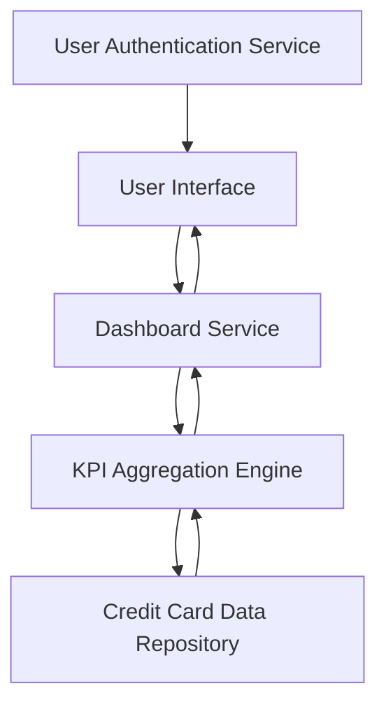

#### 1. High-Level Design

- **Summary:** This epic delivers a consolidated dashboard displaying key performance indicators (KPIs) for the user's credit card portfolio, including Monthly Spend, Total Credit Limit, Available Credit, and Outstanding Amount. The dashboard provides a multi-card view with responsive design across devices, enabling users to monitor their overall credit card financial health.

- **Component Flow:**

- **Integration Points:**
  - **Upstream:** User Authentication Service (for secure access to user-specific card information)
  - **Downstream:** Credit Card Data Repository (for retrieving card details, balances, limits, and spend data)

- **Key Assumptions:**
  - KPI calculations (Monthly Spend, Available Credit, Outstanding Amount) are computed in real-time or near-real-time from the data repository.
  - Dashboard refresh frequency is on-demand (user-initiated) or periodic (e.g., every 5 minutes).

- **NFR Highlights:** Dashboard must load within 2 seconds; system must support responsive design across desktop, tablet, and mobile devices; UI must comply with WCAG 2.1 accessibility standards.

- **Data Flow:** User authenticates via the User Authentication Service and accesses the dashboard. The Dashboard Service requests aggregated KPI data from the KPI Aggregation Engine, which queries the Credit Card Data Repository for card details, balances, limits, and transaction summaries. Aggregated metrics (Monthly Spend, Total Credit Limit, Available Credit, Outstanding Amount) are computed and returned to the Dashboard Service, which formats and delivers the data to the responsive UI for display.

#### 2. Validation Report

- **Requirements Coverage:** The design comprehensively addresses the epic's scope, including all four KPIs (Monthly Spend, Total Credit Limit, Available Credit, Outstanding Amount), multiple credit card view, and consolidated interface. The architecture supports the NFRs for 2-second load time, responsive design, and WCAG 2.1 compliance. All dependencies (Credit Card Data Repository, User Authentication Service) are integrated into the design.