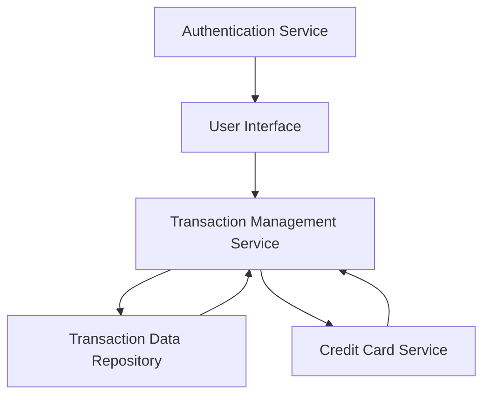

#### 1. High-Level Design

- **Summary:** This epic provides a transaction management interface enabling users to view, monitor, and search credit card transactions across multiple cards. The system retrieves historical transaction records (minimum 12 months), displays them with pagination, and provides filtering capabilities to help users track spending and detect unauthorized charges.

- **Component Flow:**

- **Integration Points:**
  - **Upstream:** User Authentication Service (for secure user session validation)
  - **Downstream:** Transaction Data Repository (for retrieving historical transaction records), Credit Card Service (for linking transactions to specific credit cards)

- **Key Assumptions:**
  - Transaction data is stored in a structured format with standard fields (date, amount, merchant, card ID, category).
  - Pagination will default to 20-50 transactions per page unless otherwise specified.

- **NFR Highlights:** Transaction list must render within 3 seconds; system must support pagination for large volumes and retrieve at least 12 months of transaction history.

- **Data Flow:** User authenticates and accesses the transaction interface. The Transaction Management Service queries the Transaction Data Repository for historical records filtered by user and card ID. The Credit Card Service provides card metadata to link transactions to specific cards. Filtered and paginated transaction data is returned to the UI for display, with options for search and filtering applied on the service layer.

#### 2. Validation Report

- **Requirements Coverage:** The design fully covers the epic's stated scope including transaction listing, details view, multi-card aggregation, and filtering/search capabilities. The architecture supports the NFRs for pagination, 12-month history retrieval, and 3-second rendering. All identified dependencies (Transaction Data Repository, Credit Card Service) are incorporated into the component flow.