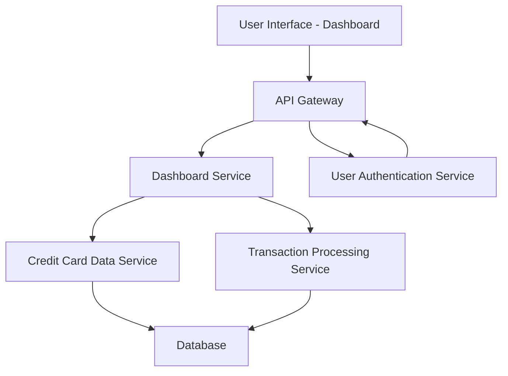

#### 1. High-Level Design

- **Summary**: This epic delivers a centralized dashboard that aggregates and displays key performance indicators (KPIs) for a user's credit card portfolio. The dashboard consolidates data from multiple credit cards to show monthly spend, total credit limit, available credit, and outstanding amounts in a responsive, modern interface accessible across devices.

- **Component Flow**:

- **Integration Points**: 
  - **Upstream**: User Authentication Service (for secure user access and session management)
  - **Downstream**: Credit Card Data Service (retrieves card information, limits, and balances), Transaction Processing Service (aggregates transaction data for spend calculations)

- **Key Assumptions**: 
  - Credit card data is pre-aggregated and available via REST APIs with sub-2-second response times.
  - KPI calculations (monthly spend, available credit) are computed server-side and cached to meet performance requirements.

- **NFR Highlights**: Dashboard must load within 2 seconds; support responsive design for mobile and desktop; handle real-time data refresh; comply with WCAG 2.1 accessibility standards.

- **Data Flow**: User authenticates via User Authentication Service → Dashboard Service fetches user's credit card list from Credit Card Data Service → Transaction Processing Service aggregates monthly spend and outstanding amounts → Dashboard Service calculates available credit (limit minus outstanding) → Consolidated KPIs are rendered on the UI with real-time refresh capability.

#### 2. Validation Report

- **Requirements Coverage**: The design fully covers the epic's stated scope including dashboard KPIs display, monthly spend tracking, credit limit aggregation, available credit calculation, outstanding amount tracking, multiple credit card view, and responsive UI layout. All NFRs (2-second load time, responsive design, real-time refresh, WCAG 2.1 compliance) are addressed through component architecture and caching strategies. Integration dependencies with credit card data service, transaction processing service, and user authentication service are explicitly mapped in the component flow.