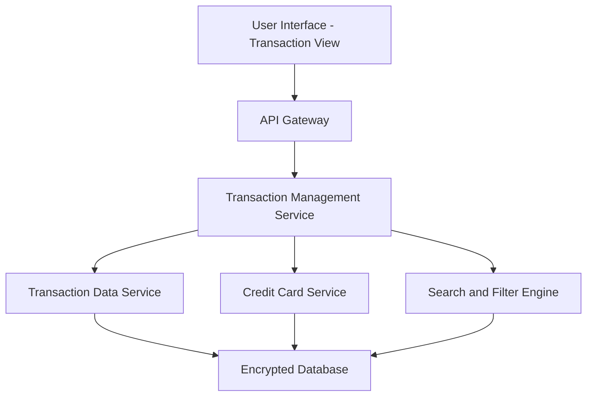

#### 1. High-Level Design

- **Summary**: This epic provides comprehensive transaction visibility across all user credit cards through a unified interface. Users can view, search, filter, and drill down into transaction details to track spending behavior. The system aggregates transaction data to support dashboard KPIs and maintains at least 12 months of transaction history.

- **Component Flow**:

- **Integration Points**: 
  - **Upstream**: Credit Card Service (associates transactions with specific cards and validates card ownership)
  - **Downstream**: Transaction Data Service (retrieves and stores transaction records with encryption), Date/Time Service (provides consistent timestamps for transaction ordering and filtering)

- **Key Assumptions**: 
  - Transactions are stored in a normalized format with standardized fields (date, amount, merchant, category, card ID).
  - Search and filter operations leverage indexed database queries to meet the 1-second response time requirement.

- **NFR Highlights**: Support retrieval of at least 12 months of transaction history; transaction queries must return results within 1 second; support concurrent access for multiple users; data must be securely stored and transmitted with encryption.

- **Data Flow**: User selects transaction view → Transaction Management Service retrieves user's card list from Credit Card Service → Transaction Data Service queries encrypted database for transactions associated with user's cards (filtered by date range, search criteria) → Search and Filter Engine applies user-specified filters → Aggregated and filtered transaction list is returned to UI within 1 second → User can drill down into individual transaction details.

#### 2. Validation Report

- **Requirements Coverage**: The design comprehensively covers all scope elements including transaction listing and display, search and filtering, multi-card transaction aggregation, transaction details view, and transaction history tracking. All NFRs are addressed: 12-month history retention (database design), 1-second query response (indexed queries and search engine), concurrent access (stateless service architecture), and encryption (secure storage and transmission). Integration dependencies with transaction data service, credit card service, and date/time service are explicitly defined and support the aggregation requirements for dashboard KPIs.