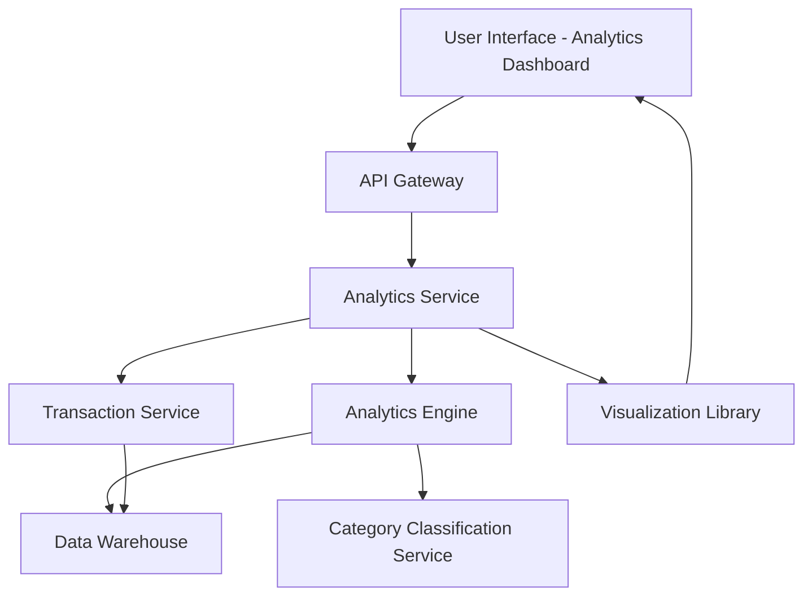

#### 1. High-Level Design

- **Summary**: This epic delivers interactive visualizations and analytics that help users understand spending patterns through category-wise analysis, monthly trends, and card-wise comparisons. Users can explore spending across 9 predefined categories (Food & Dining, Fuel, Shopping, Travel, Entertainment, Utilities, Healthcare, Education, Miscellaneous) with historical context and drill-down capabilities.

- **Component Flow**:

- **Integration Points**: 
  - **Upstream**: Transaction Service (provides raw spending data for analysis), Category Classification Service (categorizes transactions into predefined categories)
  - **Downstream**: Analytics Engine (performs data aggregation, trend calculation, and pattern identification), Visualization Library (renders interactive charts and graphs on the UI)

- **Key Assumptions**: 
  - Transactions are pre-categorized or classified in real-time using rule-based or ML-based categorization logic.
  - Analytics data is pre-aggregated in a data warehouse to support 3-second rendering of complex visualizations.

- **NFR Highlights**: Analytics visualizations must render within 3 seconds; support interactive filtering and drill-down capabilities; charts must be responsive and mobile-friendly; system must handle aggregation of large transaction datasets efficiently.

- **Data Flow**: User accesses analytics dashboard → Analytics Service retrieves user's transaction data from Transaction Service → Category Classification Service categorizes transactions (if not pre-categorized) → Analytics Engine aggregates data by category, card, and time period, storing results in Data Warehouse → Visualization Library fetches aggregated data and renders interactive charts (category breakdown, monthly trends, card-wise comparison) → User interacts with visualizations (filtering, drill-down) triggering real-time re-aggregation and re-rendering within 3 seconds.

#### 2. Validation Report

- **Requirements Coverage**: The design fully addresses all scope elements including category-wise spending visualization, monthly spend trend analysis, card-wise spend comparison, interactive charts and graphs, spending pattern identification, multi-category breakdown, and historical spending data analysis. All NFRs are satisfied: 3-second rendering (pre-aggregation and caching), interactive filtering and drill-down (client-side visualization library with server-side API support), responsive and mobile-friendly charts (responsive visualization library), and efficient aggregation of large datasets (data warehouse and analytics engine). Integration dependencies with transaction service, analytics engine, visualization library, and category classification service are explicitly mapped and support the analytical capabilities required.