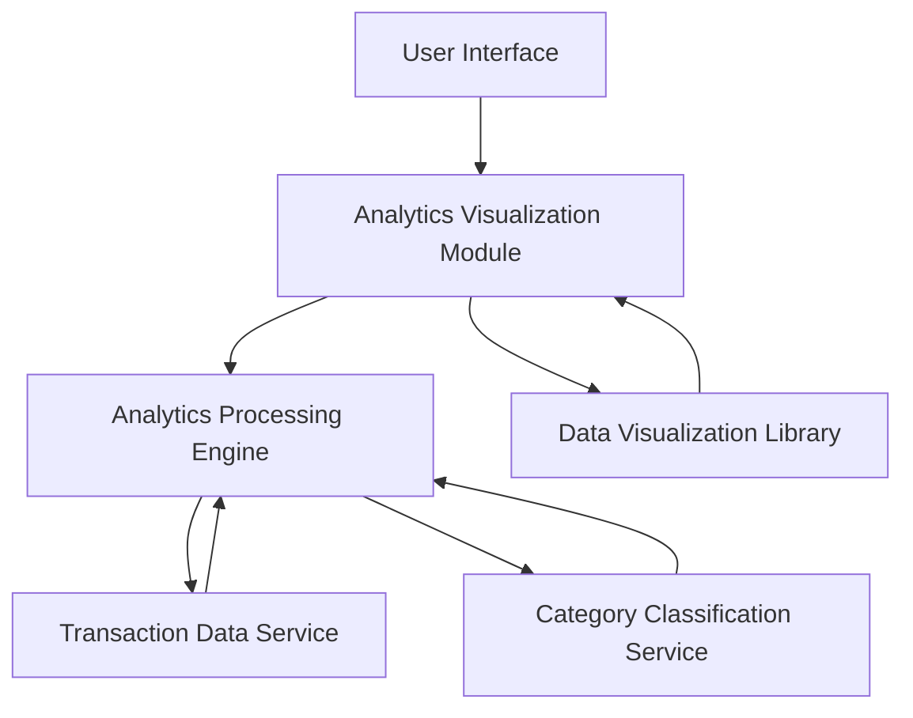

#### 1. High-Level Design

- **Summary:** This epic delivers comprehensive spending analytics and visualization capabilities that process transaction data to provide users with actionable insights into their spending behavior. Users can view monthly spend trends and analyze spending across nine predefined categories through interactive charts, enabling identification of spending patterns and opportunities for financial optimization.

- **Component Flow:**

- **Integration Points:** 
  - **Upstream:** Transaction Data Service (for raw transaction records with minimum 12 months history)
  - **Downstream:** Category Classification Service (for categorizing transactions into Food & Dining, Fuel, Shopping, Travel, Entertainment, Utilities, Healthcare, Education, Miscellaneous), Data Visualization Library (for rendering interactive charts)

- **Key Assumptions:** 
  - Transactions are pre-classified or classification occurs in real-time with acceptable latency
  - Analytics Processing Engine uses batch processing for historical data and incremental updates for new transactions

- **NFR Highlights:** Analytics must process and display data for minimum 12 months of transaction history; Visualizations must render within 3 seconds; System must handle minimum 1000 transactions per user; Charts must be interactive and responsive across all device types

- **Data Flow:** User accesses spending analytics interface → Analytics Visualization Module requests processed data → Analytics Processing Engine retrieves raw transaction data from Transaction Data Service (minimum 12 months, up to 1000+ transactions) → Category Classification Service categorizes transactions into predefined categories → Processing Engine aggregates data for monthly trends and category-wise breakdowns → Processed analytics data is returned to Visualization Module → Data Visualization Library renders interactive, responsive charts showing spend trends and category analysis → User interacts with visualizations to identify spending patterns and make data-driven financial decisions

#### 2. Validation Report

- **Requirements Coverage:** The design fully addresses all scope requirements including monthly spend trend visualization, category-wise spending analysis for all nine specified categories (Food & Dining, Fuel, Shopping, Travel, Entertainment, Utilities, Healthcare, Education, Miscellaneous), interactive charts and graphs, transaction data processing, and spending pattern identification. All NFRs are covered: 12-month transaction history support through Transaction Data Service, 3-second visualization rendering via optimized Analytics Processing Engine with caching, handling of 1000+ transactions per user through scalable processing architecture, and interactive responsive charts via modern Data Visualization Library. All dependencies are properly integrated into the component architecture.