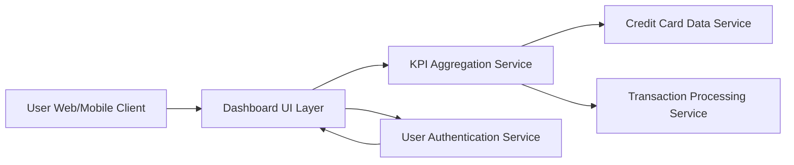

#### 1. High-Level Design

- **Summary:** This epic delivers a comprehensive dashboard interface serving as the central hub for credit card financial management. It provides users with consolidated KPIs including monthly spend, total credit limit, available credit, and outstanding amounts across all credit cards, enabling quick assessment of portfolio health and informed financial decision-making.

- **Component Flow:**

- **Integration Points:** 
  - **Upstream:** User Authentication Service (for secure access control)
  - **Downstream:** Credit Card Data Service (for card details and balances), Transaction Processing Service (for spend calculations and real-time transaction data)

- **Key Assumptions:** 
  - KPI calculations are performed server-side with caching to meet 2-second load time requirement
  - Real-time data refresh is implemented via polling or WebSocket connections with configurable refresh intervals

- **NFR Highlights:** Dashboard must load within 2 seconds; System must support responsive design across desktop, tablet, and mobile devices; Real-time data refresh capability; Support for concurrent viewing by multiple users

- **Data Flow:** User accesses dashboard via web/mobile client → User Authentication Service validates credentials → Dashboard UI Layer requests KPI data → KPI Aggregation Service fetches card details from Credit Card Data Service and transaction data from Transaction Processing Service → Service calculates monthly spend, total credit limit, available credit, and outstanding amounts → Aggregated KPIs are returned to Dashboard UI Layer → Responsive interface renders consolidated view with real-time refresh capability → User views portfolio health metrics and makes financial decisions

#### 2. Validation Report

- **Requirements Coverage:** The design comprehensively addresses all scope elements including dashboard interface design, monthly spend KPI display, total credit limit aggregation, available credit calculation, outstanding amount tracking, multi-card consolidated view, and responsive layout implementation. All NFRs are explicitly addressed: 2-second load time through KPI Aggregation Service with caching, responsive design via adaptive UI layer, real-time refresh through continuous data polling, and concurrent user support through stateless service architecture. All dependencies are integrated into the component flow.