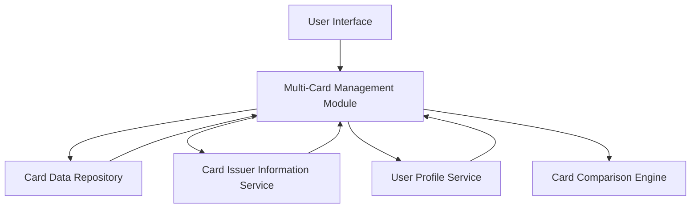

#### 1. High-Level Design

- **Summary:** This epic delivers a multi-card management interface that enables users to view, compare, and monitor multiple credit cards from a unified dashboard. Users can access individual card details, limits, status, and card-wise spend analysis to effectively manage their entire credit card portfolio from a single location.

- **Component Flow:**

- **Integration Points:** 
  - **Upstream:** User Profile Service (for card ownership validation), Card Issuer Information Service (for card metadata)
  - **Downstream:** Credit Card Data Repository (for card details, balances, and transaction data)

- **Key Assumptions:** 
  - Card data is stored in a normalized format with consistent schema across all card types
  - User authentication and authorization are handled by an external service before accessing card management features

- **NFR Highlights:** System must support minimum 10 credit cards per user; Interface must maintain performance with multiple cards loaded simultaneously; Card data must be displayed with consistent formatting

- **Data Flow:** User authenticates and accesses the multi-card interface → Multi-Card Management Module retrieves user's card list from User Profile Service → Module fetches detailed card information (limits, balances, status) from Card Data Repository → Card Issuer Information Service provides card branding and metadata → Card Comparison Engine processes card-wise spend data → Consolidated view is rendered to user with individual card details, status indicators, and comparison metrics

#### 2. Validation Report

- **Requirements Coverage:** The design fully covers the epic's stated scope including multiple credit card display, individual card details view, card-wise spend analysis, card comparison functionality, card status indicators, and card selection/filtering. All NFRs regarding support for minimum 10 cards, consistent formatting, and performance are addressed through the modular architecture. Dependencies on credit card data repository, card issuer information service, and user profile service are explicitly integrated into the component flow.