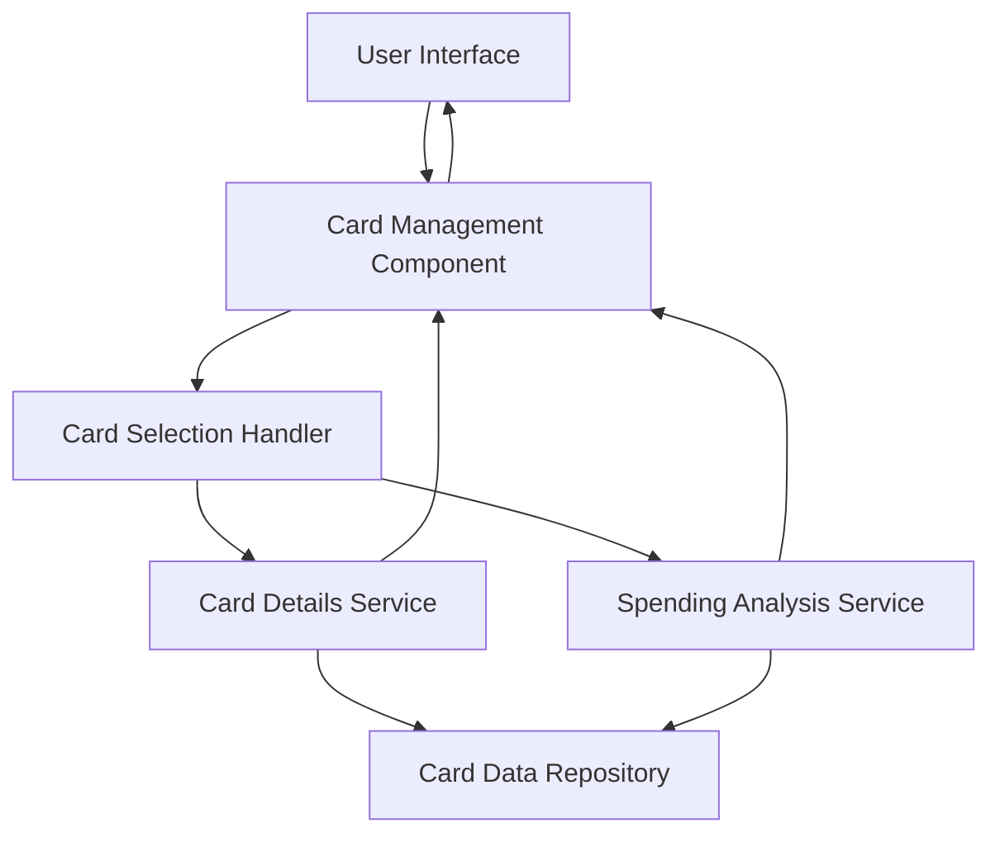

#### 1. High-Level Design

- **Summary:** This epic enables users to manage and view multiple credit cards within the dashboard interface. The core requirement is to provide organized display of all credit cards with the ability to view individual card details, card-wise spending analysis, and monthly spend trends for each card, supporting granular visibility into usage patterns and financial metrics.

- **Component Flow:**

- **Integration Points:**
  - **Upstream:** Credit card data service for retrieving individual card transaction histories, spending data, and card metadata
  - **Internal:** Card Selection Handler for managing navigation between multiple cards
  - **Internal:** Spending Analysis Service for calculating card-wise spending trends and monthly patterns

- **Key Assumptions:**
  - Each card has a unique identifier for filtering and retrieving card-specific data
  - Monthly spend trends are calculated for a default period (e.g., last 12 months) with configurable date ranges

- **NFR Highlights:** System must support display and analysis of multiple credit cards simultaneously; Card switching and filtering must be performant; Data visualization must render efficiently for trend analysis

- **Data Flow:** User views the card management interface displaying all their credit cards in an organized list or grid. When a user selects a specific card, the Card Selection Handler triggers requests to the Card Details Service and Spending Analysis Service. The Card Details Service retrieves card-specific information (card number, type, limit, balance) from the Card Data Repository. The Spending Analysis Service retrieves transaction history for the selected card and calculates monthly spend trends and card-wise spending patterns. The Card Management Component renders individual card details, spending visualizations, and trend charts in the UI. Users can switch between cards with performant loading and compare spending across multiple cards.

#### 2. Validation Report

- **Requirements Coverage:** The design fully addresses the epic's scope including multiple credit card display, card-wise spend analysis, monthly spend trends per card, individual card detail views, and card selection and navigation. All NFRs related to simultaneous multi-card support, performant card switching and filtering, and efficient data visualization rendering are incorporated into the architecture. Integration dependencies with credit card data services for transaction histories and spending data are explicitly defined.