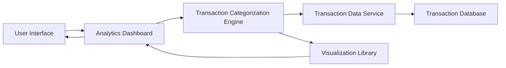

#### 1. High-Level Design

- **Summary:** This epic provides interactive analytics and visualizations enabling users to understand spending patterns through category-wise analysis. The core requirement is to deliver detailed transaction breakdowns across predefined categories (Food & Dining, Fuel, Shopping, Travel, Entertainment, Utilities, Healthcare, Education, Miscellaneous) with actionable insights for financial optimization.

- **Component Flow:**

- **Integration Points:**
  - **Upstream:** Transaction data service for retrieving categorized transaction history
  - **Downstream:** Data visualization libraries (e.g., Chart.js, D3.js, or similar) for rendering interactive charts and graphs
  - **Internal:** Transaction Categorization Engine for mapping transactions to predefined spending categories

- **Key Assumptions:**
  - Transactions are pre-categorized by the data service or categorized on-the-fly using rule-based logic
  - Analytics support filtering by date range, card, and category with default view showing current month data

- **NFR Highlights:** Visualizations must be interactive and responsive; Analytics must support filtering and drill-down capabilities; Chart rendering must be optimized for performance with large transaction datasets

- **Data Flow:** User accesses the analytics dashboard and selects filters (date range, card, category). The Analytics Dashboard requests transaction data from the Transaction Data Service, which retrieves raw transaction records from the Transaction Database. The Transaction Categorization Engine processes and groups transactions by category, calculating aggregated spending per category. The Visualization Library renders interactive charts (pie charts, bar graphs, trend lines) displaying category-wise spending breakdowns. Users can interact with visualizations to drill down into specific categories and view detailed transaction lists.

#### 2. Validation Report

- **Requirements Coverage:** The design comprehensively covers the epic's scope including category-wise spending visualization, interactive charts and graphs, transaction categorization, spending pattern analysis, multi-category breakdown, and analytics dashboard. All NFRs related to interactivity, responsiveness, filtering, drill-down capabilities, and performance optimization are addressed through the component architecture. Integration dependencies with transaction data services and visualization libraries are explicitly incorporated.